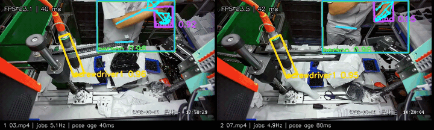
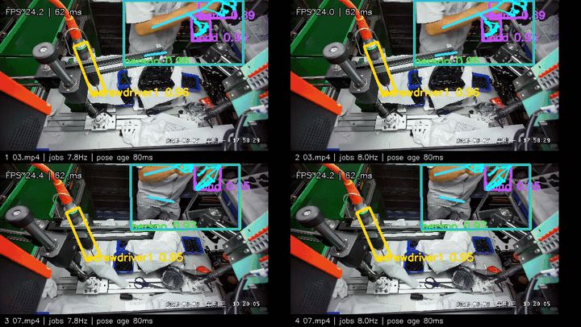
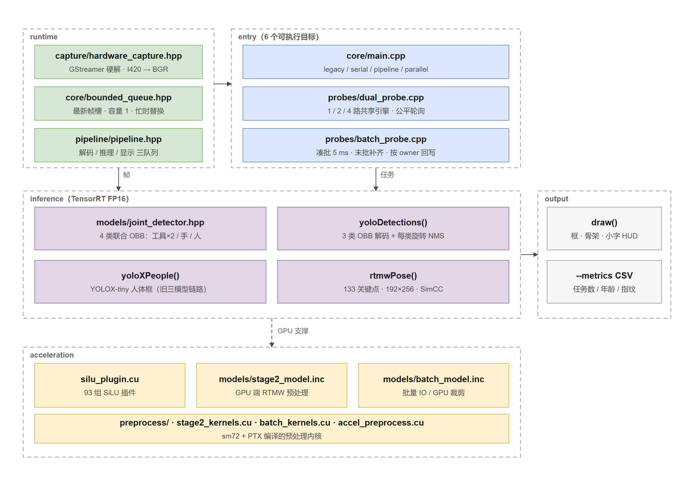

<div align="center">

# SOP Monitor

**工业 SOP 视觉推理引擎 · 工具 / 手旋转框检测 + 133 点人体姿态 · 四路共享 TensorRT 引擎**


</div>

C++17 + TensorRT FP16 的实时推理工程：输入工位视频，联合 OBB 检测螺丝刀与手部，RTMW 输出人体及双手关键点；四路共享一套引擎按批调度，**四路合计最高 66.8 次新识别/秒**。

## 效果预览

**双路实时**（联合 OBB + RTMW）

[](docs/media/twolane_10s_v2.mp4)

**四路 · 批量调度**（640×384 + batch 4）

[](docs/media/fourlane_10s_v2.mp4)

> 录屏为 10 秒实机片段，点图看原速 MP4。输入是两段工位视频文件，非真实 RTSP。

## 架构



采集层硬解交付 I420 并转 BGR，投递到容量 1 的最新帧槽；三个入口（单路 / 多路探针 / 批量探针）共用同一套模型与后处理；加速层通过 SiLU 插件、GPU 预处理和批量内核支撑推理。

## 技术亮点

**1. 两模型链路，省掉一次前向**
把「工具/手 OBB + YOLOX 人体检测 + RTMW」压成「四类联合 OBB（工具×2 / 手 / 人）+ RTMW」：一次检测同时给出工具、手和人体框，省掉一次完整前向，四路吞吐提升 9.6%。

**2. 自写 TensorRT SiLU 插件**
Xavier 上 TensorRT 8.5 的启发式策略失效，四类联合 OBB 全候选构建超过 23 分钟仍不出结果。定位到 93 组 `x·sigmoid(x)` 激活的策略搜索是瓶颈后，用 CUDA 插件整体替换，支持 FP16/FP32、按调用方 stream 执行、无内部 workspace，引擎恢复可构建。插件与 `.plan` 绑定，部署时须成对携带。

**3. 矩形输入 + 跨工位批处理**
1920×1080 等比缩放到 640×360 后只补到 640×384（原方形输入上下各补 140 px），模型输入像素减少 40%；配合检测/骨架 batch 1/2/4 与 5 ms 凑批窗口，四路吞吐再提升 67%，达到 **18.92 次/秒/路**。末批不足时用最后一项补齐，只回写真实输入。

**4. 让性能数字可复核**
每路只有容量 1 的最新帧槽，忙时丢弃未开始任务而不排队；结果带源帧编号，超过 200 ms 年龄即隐藏；CSV 记录真实任务数、人体裁剪数、结果年龄与结果指纹。**窗口刷新率与识别率分开统计**，不用显示帧率冒充吞吐。

**5. 先量化瓶颈，再决定优化方向**
引擎级基准显示 OBB 单张 5.78 ms、RTMW 单裁剪 4.58 ms（batch 4），而 CPU 侧旋转 NMS 与 SimCC 解码合计占比不足 3%，CUDA Graph 也只带来 4–5% 提升。据此判断瓶颈在引擎执行区间，优化预算全部投向输入尺寸与批处理，而不是把后处理搬到 GPU。

## 性能

最新版本：640×384 矩形输入 + batch 4 的四路共享引擎。Jetson Xavier NX，两段工位视频各复制两路，每组 30 s、前 5 s 预热不计。

| 指标 | 数值 | 条件 |
|---|---:|---|
| 每路新识别 | **18.92 次/秒** | 无画面 |
| 每路新识别 | 16.71 次/秒 | 带四宫格画面 |
| 四路合计 | 75.68 / 66.85 次/秒 | 无画面 / 带画面 |
| 骨架结果年龄 P95 | 120 ms | 超过 200 ms 即隐藏 |
| OBB 检测吞吐 | 173 图像/秒 · 5.78 ms/张 | 引擎级，batch 4，不含前后处理 |
| RTMW 骨架吞吐 | 218 裁剪/秒 · 4.58 ms/裁剪 | 引擎级，batch 4 |
| 单元与预处理测试 | 5/5 通过 | CTest |

四路各 25 次识别/秒（合计 100）尚未达到；下一步是 INT8 校准与人体低频检测 + 跟踪。

## 代码结构

```text
sop_Monitor/
├── src/                       按职责分模块
│   ├── core/                  引擎封装、前后处理、绘制、队列、计时
│   ├── capture/               视频采集与 H.265 硬解
│   ├── preprocess/            GPU kernel：letterbox / warp / 色转
│   ├── models/                模型后处理：OBB 解码、NMS、SimCC
│   ├── pipeline/              单路流水线与批量调度
│   ├── probes/                6 个可执行入口（每个文件 = 一个目标）
│   ├── config/                参数系统（位置参数 / preset / 覆盖）
│   └── silu_plugin.cu         SiLU 插件（引擎依赖）
├── config/                    运行预设 YAML（1lane / 2lane / 4lane）
├── scripts/                   构建、基准测试、数据分析、一键启动
├── docs/                      架构文档、专题指南、测试报告、媒体
│   └── design/                需求基线与技术方案
├── tests/                     CTest 5 项：插件 / 队列 / 预处理
├── QUICKSTART.md              快速开始（三条命令跑起来）
└── README.md                  本文件
```

探针入口通过宏 + 直接 `include` 复用 `core/main.cpp`，保证模型变换、阈值与后处理完全一致。
模块依赖与调用关系见 [CODE_MAP.md](docs/architecture/CODE_MAP.md)；
日常运行见 [QUICKSTART.md](QUICKSTART.md)。

## 构建

```bash
cd /path/to/sop_Monitor
bash scripts/build/build_engines.sh                      # 生成 FP16 引擎（需在目标设备）
cmake -S . -B build -DSOP_BUILD_ACCEL=ON && cmake --build build -j2
(cd build && ctest --output-on-failure)

日常运行请看 [QUICKSTART.md](QUICKSTART.md)。
```

依赖 JetPack 5.1.1 / CUDA 11.4 / TensorRT 8.5.2 / OpenCV 4.5.4；`-DSOP_BUILD_ACCEL=ON` 额外需要 `libavformat`、`libavutil`、`libswscale`。权重与引擎不入库，需自行放置。

## 说明

- 输入为**视频文件模拟**，真实 RTSP 的网络抖动与断流重连尚未验证。
- 多人场景只输出得分最高的一个骨架，不是多人姿态产品。
- 矩形 + batch 配置的**精度尚未做标注验收**（12 张固定帧中 1 张手框数量变化），速度结论不等于可上线配置。

## 许可

Apache License 2.0，见 [LICENSE](LICENSE)。第三方模型权重不在本仓库许可范围内。
