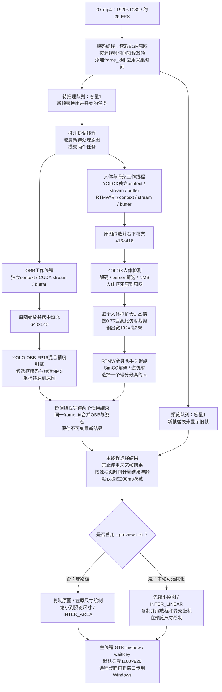
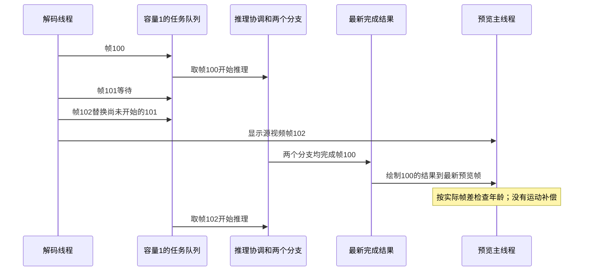
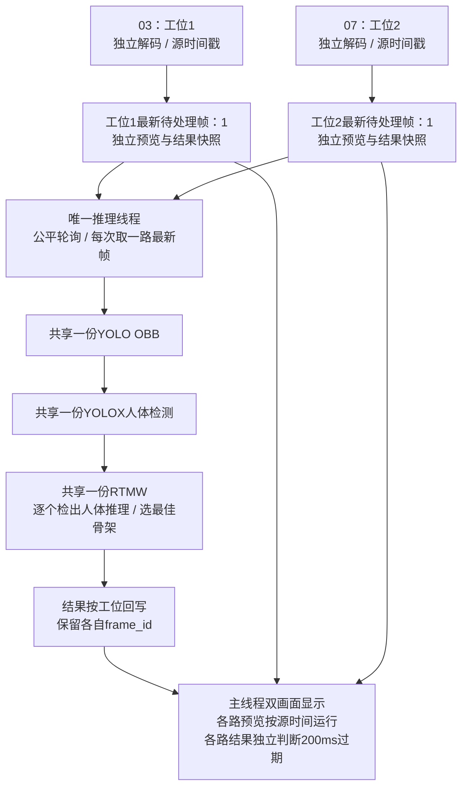
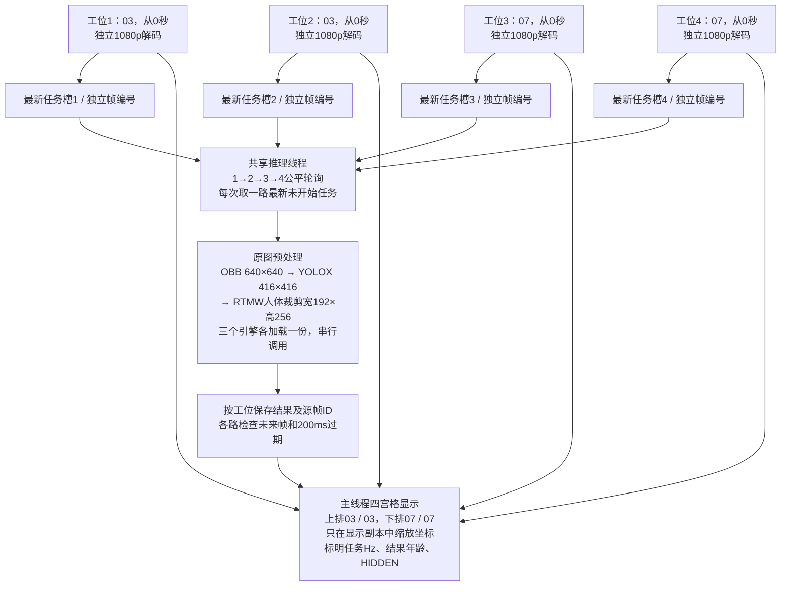
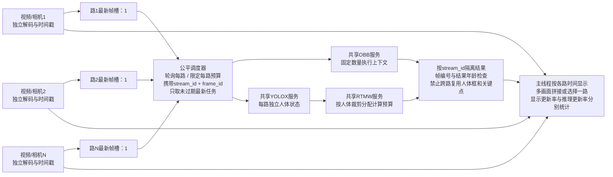

# 从原图到窗口：当前实现与多路扩展

> 2026-10-19新增联合OBB＋RTMW两模型实验，见 [JOINT_MODEL_GUIDE.md](JOINT_MODEL_GUIDE.md)。已核实实际目标为Xavier NX、计算能力7.2，历史Orin NX称呼不准确。下文保留三模型及四路共享串行实验图，按各入口区分。

## 阅读边界

本文区分 **已实现**、**本轮容量实验** 和 **后续设计**。当前 `sop_nx_infer` 的一次启动只有一个 `--source`，没有批处理推理。独立的 `sop_nx_dual_probe` 支持两路或四路文件实验，共享三份引擎、轮询处理；它不是完善的多摄像头产品。多开原程序也可以同时处理多个文件，但每个程序重复加载三份引擎和缓冲区。

原图 1920×1080、约 25 FPS 是测试文件 07 的属性；程序不强制所有输入都采用这个尺寸或帧率。输入模型的尺寸固定，预览尺寸由参数控制。RTMW 会对检出的多个人分别推理，但当前只保留上半身得分最高的一个人的骨架用于显示，不是完整的多人姿态输出。

## 1. 已实现：单路实时并行模式

启动参数：`--mode parallel --realtime`。五个应用线程不包括 OpenCV、CUDA 或显示库可能创建的内部线程。



两个分支在宿主线程上并行；实际 CUDA 内核的重叠程度没有用 GPU profiler 验证。YOLOX→RTMW 有数据依赖，仍按先检测、后裁剪、再关键点推理执行。同一个模型执行上下文不会由两个线程同时调用。

### 帧、结果和时间的含义



实时模式的流畅播放不代表每帧都经过三模型。25 FPS 视频每帧约40 ms；例如结果落后3帧，对应源时间年龄约120 ms。这个年龄不包含显示器呈现、xrdp/VNC传输及Windows客户端延迟。`capture_to_display` 测到绘制前；本轮新增 `render_p95_ms` 包含应用绘制、imshow和waitKey，但仍不是屏幕呈现延迟。

固定帧模式省略 `--realtime`：输入和结果FIFO各容量2，逐帧等待匹配结果，用于可重复性能和一致性对比。`legacy` 默认路径保持原串行行为。

## 2. 本轮优化：只减少预览开销

`--preview-first` 在预览尺寸上绘制，模型继续读取原始完整图像。框和关键点仅在显示副本中按实际缩放比例变换，推理输出和结果指纹保持原样。

适用：非legacy、有窗口、不录制。参数组合不满足时明确报错。录制继续走原有完整分辨率路径，避免无意改变输出视频尺寸。预览采用双线性缩放，文字、线条在最终尺寸绘制，视觉粗细与原路径会不同；这不提高模型准确率。

## 3. 多路能力：当前能测什么

当前可多开独立进程做容量实验。`benchmark_capacity.sh` 用同一段07文件分别运行1、2、3个独立实例；每个实例三模型均启用、实时调度、无窗口。每路使用独立解码器和模型资源，便于检验GPU竞争和重复加载的成本。

此实验不等同于：真实摄像头网络负载、单进程共享模型调度、多窗口/拼接显示、长时间稳定性、多人密集场景、业务准确率验收。尤其不能把各路预览25 FPS当作各路25次新识别/秒。应读取每路实际任务更新率、关键点年龄、丢弃任务数及资源日志。

## 4. 已实现的两工位共享串行实验

`sop_nx_dual_probe` 使用两个解码线程、一个推理线程、一个主显示线程。推理线程是三个模型的唯一调用者。每次选择一路最新任务，依次执行OBB→YOLOX→RTMW；完成后优先选择另一路。两路结果分别保存，不能串路。第一版探针通过编译时嵌入原推理实现复用模型代码，后续产品化应提取共享推理模块；本轮不做大范围文件重构。



探针每个选中任务都运行全部模型，不设置模型跳帧；忙时只替换未开始任务。两路视频都能播放不代表两路每帧都识别。统计前5秒作为启动预热，后续记录每路已完成任务率；CSV及日志仍保留启动段。退出或时间截止时可能丢弃尚未开始的任务，当前GPU任务会完成后退出。

```bash
./build/sop_nx_dual_probe --source ../test_vedio/03.mp4 \
  --second-source ../test_vedio/07.mp4 --model-dir models \
  --start-sec 180 --duration 30 --metrics output/dual.csv
```

预期出现一个窗口，左03、右07；按q或Esc退出。必须显式指定大于5秒的duration。自动对比无窗口和双画面：`bash benchmark_dual_station.sh`。源视频按各自FPS定时读取，尚未接相机、网络断流重连和跨设备时钟同步。

### 四路扩展：已实现

保持同一个实验可执行文件，同时指定third-source/fourth-source启用四路；二者必须成对出现。四路为4个解码线程＋1个串行推理线程＋1个主显示线程，三模型各一份。四路独立使用原图，预览采用固定四宫格、只更新发生新帧的格子，避免重复绘制其它格子。主线程按照最高源FPS（本次约25）合批提交显示，避免四个解码器的错峰发布触发多次整窗刷新。默认原图尺寸不变，四路输入的模型尺寸也不变。



测试数据见 [四路报告](FOUR_STREAM_REPORT_20261016.md)。这次模拟从0秒开始，不与之前180秒位置的两路结果直接比较。四路能播放和四路能持续产生新识别结果必须分别验收；增大窗口或放宽显示过期阈值不会增加模型算力。

### 进程、线程与后续联合检测

- 当前四路已经使用多线程：1个进程中的6个应用线程。OpenCV/FFmpeg等库可能另建内部线程，操作系统看到的线程总数可能更多。线程共享本进程中的模型对象、帧和结果快照，用锁及有界槽保护状态。
- 独立进程各有地址空间，适合故障隔离，但四个完整程序会重复加载模型及缓冲区，并竞争同一GPU。先前多进程实验出现过系统内存和交换区压力；不按进程数线性估计性能。
- 后续可考虑采集进程与共享GPU推理服务，通过有界共享内存传帧，但要增加同步、重连及服务恢复管理。本轮文件探针没有这些产品功能。
- 用户提出让OBB同时检测工具、手和人体，再直接接RTMW：当前OBB类别只有screwdriver1、screwdriver2和hand，需要增加人体标注并训练、验证召回率，再按RTMW约定形成原图人体裁剪框。本轮没有训练或替换权重。
- 对当前串行探针，联合检测有机会省下YOLOX推理及前后处理。对原单路并行版，OBB原本可以与YOLOX→RTMW重叠；联合后RTMW须等待OBB人体框。因此减少一个模型调用不等于系统帧率必然提高，必须重新测吞吐、骨架延迟及工具/人体/手的识别质量。

## 5. 后续设计：共享并行服务与任意路数（尚未实现）



此路线能控制重复内存和任务公平性，但不会凭空增加GPU算力。与多进程相比，需要增加调度、每路状态和异常隔离；因此先做容量实验，再决定是否值得接入多路主程序。

## 6. 后续优化优先级与取舍

| 方向 | 解决的问题 | 代价或风险 | 当前状态 |
|---|---|---|---|
| 预览先缩小再绘制 | 减少CPU绘图和复制开销 | 改变预览插值和线条视觉粗细 | 本轮实现可选项，实测见报告 |
| 硬件解码与缩放 | 多路解码的CPU占用和搬运 | 需核实本机GStreamer插件、输入编码和内存路径 | 未实现 |
| CUDA预处理与缓冲复用 | 减少CPU逐像素转换及分配/拷贝 | 需与原归一化、填充和仿射结果逐项对齐 | 未实现 |
| 人体低频检测加跟踪 | 减少YOLOX重复计算 | 漂移、遮挡、人员变化时必须重新检测 | 未实现 |
| 手与人体时序滤波 | 降低关键点抖动 | 增加滞后，需按人关联和重置；不是模型精度提升 | 未实现 |
| 运动补偿 | 减少旧结果与新画面的错位 | 快速手部动作和遮挡时易误推，需置信度保护 | 未实现 |
| 单进程多路公平调度 | 控制内存和每路饥饿 | 改动调度结构，需要每路故障隔离与长测 | 两路串行探针已实现；共享并行服务待实现 |
| INT8或轻量模型 | 减少神经网络计算量 | 校准数据和准确率回归必需，手部尤其敏感 | 未实现 |

不同时打开全部优化。先固定输入、比较真实更新率、时间年龄和结果一致性，再评估效果；平滑或预测只能在标明推断结果并验证快速动作后加入。
