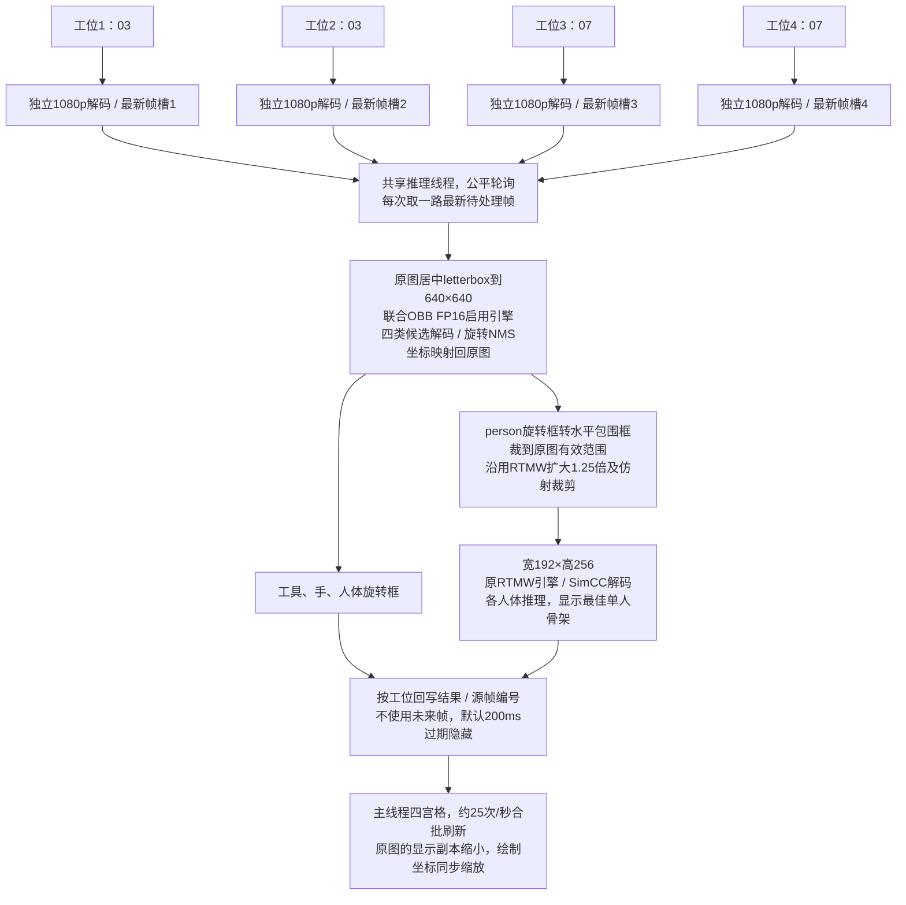

# 联合OBB＋RTMW两模型入口

## 模型与边界

**硬件更正（2026-10-19）：** 实际SSH目标192.168.137.230的设备树是NVIDIA Jetson Xavier NX Developer Kit；TensorRT报告Xavier、Compute Capability 7.2、6个SM、可见GPU内存6848 MiB。此前沿用的Orin NX名称未经硬件核实，本仓库历史测试数字属于这台Xavier NX，不能作为Orin NX结果。

新入口 `sop_nx_joint_probe` 使用2026-10-18训练的四分类YOLO26n-OBB：screwdriver1、screwdriver2、hand、person。一次检测同时提供工具、手和人体框，然后从原图人体区域裁剪给原RTMW。它不加载YOLOX，也不加载旧三分类OBB。这里是用联合检测模型替换两个检测器，未将RTMW网络合入OBB权重。

原 `sop_nx_infer`、`sop_nx_dual_probe` 及旧引擎保留。新两模型入口默认使用model-dir下的joint_20261018/joint_fp16.plan，也可显式覆盖；把旧三分类引擎传入会因输出形状不符而报错，不能静默作为新模型运行。

### 数据流程



一个进程，四路时有4个解码线程、1个推理线程、1个主显示线程，库内部可能另建线程。检测与RTMW在本轮串行执行；没有声明共享服务流水线、GPU批处理、跨任务并发或硬件解码已经实现。RTMW依然只显示最佳单人，不是多人骨架产品。

## 导出与构建

用户原始ONNX输出 `[1,300,7]`、end2end=True，含TopK。`tools/prepare_joint_onnx.py` 只截取TopK前的 `[1,8400,9]`，不修改权重，保留原始ONNX。原始7字段为框xywh、score、class、angle；候选9字段为xywh、4类score、angle。

转换是开发工具，可使用Python；NX运行推理是C++。转换脚本需要已有onnx环境，不自动安装依赖：

```text
python tools/prepare_joint_onnx.py ORIGINAL.onnx models/joint_20261018/best.raw.onnx
```

C++按四类置信度0.25筛选，最多300个候选，沿用每类旋转IoU阈值0.55去重。原end-to-end尾部是TopK筛选，C++显式NMS可能改变重叠框数量；因此需要对照候选输出与实际解码，不能声称后处理与原尾部完全相同。人体阈值0.25沿用联合模型配置，不等于原YOLOX的0.3。

在NX本机构建插件与程序，再生成引擎：

```bash
cmake -S . -B build -DCMAKE_BUILD_TYPE=Release
cmake --build build -j2
bash build_joint_engine.sh
```

生成到独立的 `models/joint_20261018/joint_fp16.plan`，脚本发现已存在引擎时拒绝覆盖。FP16启用允许TensorRT混合选择精度，不代表每层都使用FP16。旧RTMW引擎复用，旧OBB和YOLOX引擎不变。

首次全候选构建约23分钟仍未结束，已停止并保留日志。启发式请求被Xavier明确忽略；后续限定tactic sources、精度/布局及首策略选择的尝试没有解决前段测量耗时。CUDA和旧模型运行健康检查通过，详细日志显示SiLU PointWiseV2的布局/策略搜索耗时较大。

最终路径另存`best.silu.onnx`，用`SopSiLU` CUDA插件替换93组完全匹配的x×sigmoid(x)，不替换单独的Sigmoid、不更改权重。插件支持LINEAR格式FP32/FP16，按调用者CUDA stream执行，无内部共享缓冲和workspace。FP16内部转float计算再转回half，数值差异需通过参考输出检查，不宣称逐位等同原TensorRT融合实现。插件源码`src/silu_plugin.cu`由现有CUDA 11.4编译，不安装新SDK；二进制包含sm72和compute72 PTX。构建器约束骨干浮点计算为FP16（OBEY_PRECISION_CONSTRAINTS），保留model.23头的混合精度选择，avgTiming=1，最多6个构建线程，正常测量选择策略，不使用首策略/linear-only诊断选项。内部仍可能重排布局，实际并行编译线程数没有单独证明。

引擎依赖`build/libsop_silu_plugin.so`，新C++入口链接并注册插件；移动或部署时须一起保留库。原三模型入口不依赖该插件。所有数值及性能结论仅适用于这版引擎，不代表设备极限。插件数值测试通过不替代整模型检测及人体裁剪效果验证。

## 运行

先退出其它推理进程，避免影响性能比较。单路验证：

```bash
./build/sop_nx_joint_probe --single-source --source ../test_vedio/03.mp4 \
  --model-dir models --yolo-engine models/joint_20261018/joint_fp16.plan \
  --start-sec 0 --duration 30 --metrics output/joint_single.csv
```

四路，从开头：

```bash
./build/sop_nx_joint_probe --source ../test_vedio/03.mp4 \
  --second-source ../test_vedio/03.mp4 --third-source ../test_vedio/07.mp4 \
  --fourth-source ../test_vedio/07.mp4 --model-dir models \
  --yolo-engine models/joint_20261018/joint_fp16.plan \
  --start-sec 0 --duration 300 --metrics output/joint_four_live.csv
```

上排03/03、下排07/07；q/Esc退出。duration必须大于5秒。程序前5秒作为启动预热，日志steady_job_hz统计之后完成的任务；标签jobs Hz包含启动段，两者不能混为同一个窗口。画面FPS不是新识别Hz。

## 对照测试与审计

本轮实际数据、数值检查失败项与验收边界见 [JOINT_TEST_REPORT_20261019.md](JOINT_TEST_REPORT_20261019.md)。新入口是实验版本，不替换默认程序；四路25 Hz/路尚未达到。

`bash benchmark_joint_four.sh` 使用同一段四路输入，分别运行旧三模型与新两模型，各无窗口30秒、四宫格30秒。保留200ms过期阈值，记录各路任务更新率、人体裁剪次数、骨架年龄、无骨架与过期比例以及系统资源。

探针新增 `--audit-dir EXISTING_DIRECTORY`，保存每路第一个实际推理帧、OBB解码CSV、带框及骨架的审计图；只用于短时转换验证，不在性能对照测试中启用。`tools/verify_joint_audit.py` 在已有ONNX Runtime环境比较原ONNX与raw候选、raw候选的C++后处理参考和TensorRT C++结果。数值一致性验证不能替代标注准确率。

CSV在旧列后追加detector_ms、pose_ms、person_count、result_hash。person_count是该最新结果中的人体框数，不是累计调用次数。detector_ms：两模型入口为联合OBB预处理/推理/后处理；旧入口为旧OBB加YOLOX全链路。pose_ms是RTMW裁剪及推理/解码。按显示帧重复记录结果时不要重复计为新推理任务。

## 版本和回退

- 原始ONNX SHA256：`02db79031b7eea951d6120090cd3ba2e509c28235de0e043cb4bfc7b2aaaab57`。
- raw ONNX SHA256：`ce0ebcf98519f3fa5d5aa6f70fa3688ed34cd4f7deedd7e3ce88becaa51b4d69`。
- 不使用权重目录中指向旧sop_test路径的X-AnyLabeling配置，实际来源是sop_test1。
- 回退运行：启动原sop_nx_dual_probe即回到三模型；原sop_nx_infer不受影响。
- 文件备份：NX `/tmp/sop-joint-before-20261019/` 保存本轮修改前dual_probe.cpp和CMakeLists.txt；它们包含此前尚未提交的四路功能。恢复这两个文件后重新构建即可撤去本轮入口依赖；新增源/工具/报告可保留，不清理模型或用户数据。
- 本轮未自动提交/推送，不覆盖此前四路未提交修改。仅在NX Linux ARM64验证；真实摄像头取流、断流恢复与其它平台兼容性尚待验证。
