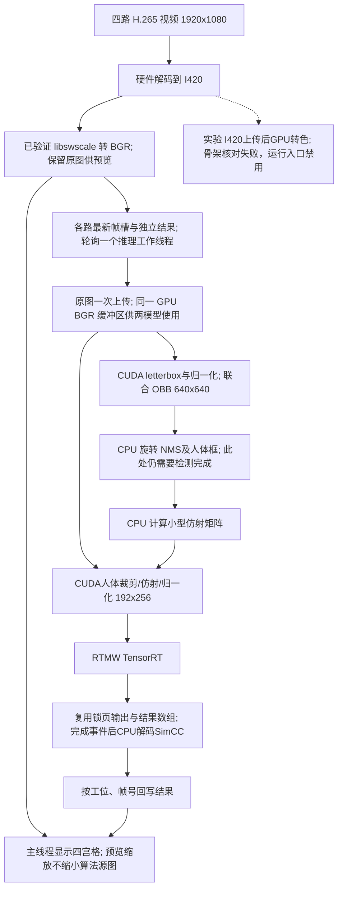

# 第二轮 GPU 前处理与 I/O 实验

基线已经提交：`ad0c60c` 包含两模型、四路和硬件加速方案；`6cfe9e9` 仅修正换行。
未推送。第二轮实验源代码单独保留为工作区修改。

## 保留与新增

原 `sop_nx_accel_probe` 继续运行已提交的方案。新入口是 `sop_nx_stage2_probe`。
同一联合 OBB + RTMW、相同阈值、200 ms 结果过期限制、同样的四路最新帧队列。
没有更换权重、TensorRT 引擎、模型精度或输入尺寸。



### GPU RTMW

复用 OBB 已上传的 GPU 原图；不在 CPU 上生成 192x256 裁剪和 CHW 浮点张量。
仿射坐标按 OpenCV 的 AB_BITS=10、1/32 插值表、常量零边界实现。
归一化用原 CPU 的双精度常量/计算后转 float，保持原通道顺序。
小型仿射矩阵仍由 CPU 计算，SimCC 的峰值解码仍由 CPU 完成。

### I/O 复用

每个模型实例独立持有锁页输入/输出缓冲区、结果容器和完成事件。
CPU 使用输出前必须等待 GPU 完成，未删除这项必要等待。
OBB 结果在 CPU 上确定 RTMW 的人体裁剪框，所以两个模型仍有串行依赖。
复用的是推理 I/O，不是宣称整个程序逐帧零分配。

### YUV 原型边界

I420 上传可将1080p源图的主机到GPU数据从6,220,800字节减为3,110,400字节，
但原型颜色转换在骨架上出现超过阈值的差异。因此 `--source-layout i420` 在运行
入口提前拒绝，只保留 `stage2_test ... --i420 VIDEO...` 诊断。没有将失败路径设为默认。
目前仍存在 CPU I420/BGR 转换和图像复制，不能称为零拷贝方案。
成功路径也减少了 RTMW 裁剪张量的单独上传：两模型共享一次上传的 GPU 原图。

## 构建与启动

```bash
cd /home/nvidia/Music/project/sop_Monitor/cpp_infer
cmake -S . -B build -DSOP_BUILD_ACCEL=ON
cmake --build build -j2
(cd build && ctest --output-on-failure)

./build/sop_nx_stage2_probe \
  --source ../test_vedio/03.mp4 --second-source ../test_vedio/03.mp4 \
  --third-source ../test_vedio/07.mp4 --fourth-source ../test_vedio/07.mp4 \
  --duration 300 --workers 1 --pose-preprocess cuda --source-layout bgr --reuse-io on
```

`--pose-preprocess cpu|cuda`、`--reuse-io on|off` 用于单独比较。
本轮实测选择GPU姿态、BGR源图和I/O复用开启作为新入口默认值；旧入口默认不变。
锁页内存和事件不会自动保证提速，本轮选择来自对照结果。
Q/Esc 退出；顶部FPS为预览，底部jobs为新识别Hz。
硬解非零 `--start-sec` 的限制保留，需跳转时改用 `--decoder opencv`。

验证命令：

```bash
./build/stage2_test
./build/stage2_test models/joint_20261018/joint_fp16.plan build/rtmw.plan \
  ../test_vedio/03.mp4 ../test_vedio/07.mp4
./build/stage2_test models/joint_20261018/joint_fp16.plan build/rtmw.plan \
  --i420 ../test_vedio/03.mp4 ../test_vedio/07.mp4
python3 benchmark_stage2.py --phase headless --duration 30
python3 benchmark_stage2.py --phase gui --duration 30
python3 benchmark_stage2.py --phase soak --duration 120 --reuse-io on
```

第三条是失败原型诊断，预期不能视为一致性通过。Python 仅编排实验，推理仍为 C++。

## 回退与范围

直接运行原 `sop_nx_accel_probe` 可回到上一轮入口。第二轮源码修改前的副本位于
`output/stage2_20261019/before/`。恢复其中 main.cpp、dual_probe.cpp、joint_detector.hpp、
pipeline.hpp、hardware_capture.hpp 到 src/，恢复 accel.cmake 到本目录，再重新构建。
新增 stage2 文件可保留为未引用文件。不需要重写 Git 历史，也不需要恢复视频或引擎。

实际硬件仍是 **Xavier NX**。本轮是四路文件模拟；真实相机、断流恢复、HDR、不同颜色
矩阵以及长期运行没有获得新的验证。所有像素/模型一致性结论只覆盖报告中的测试样本。
