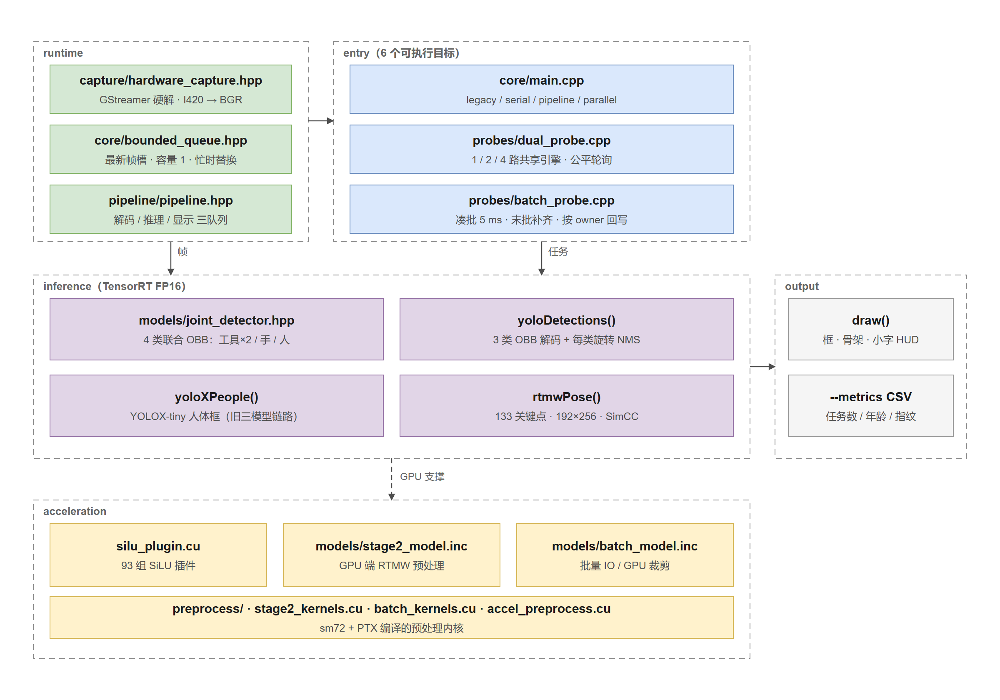
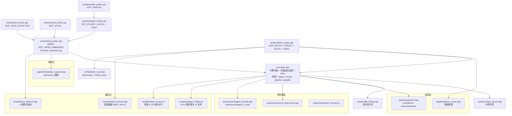
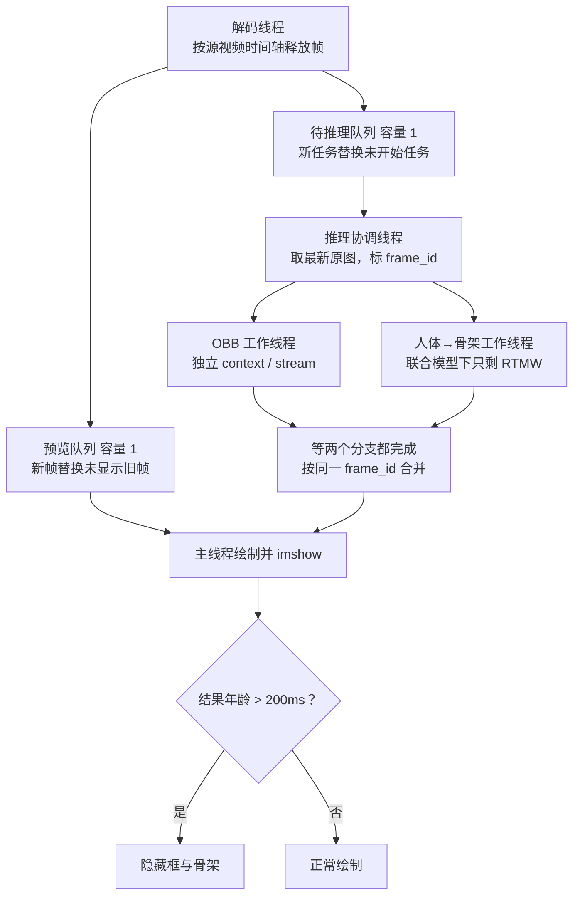
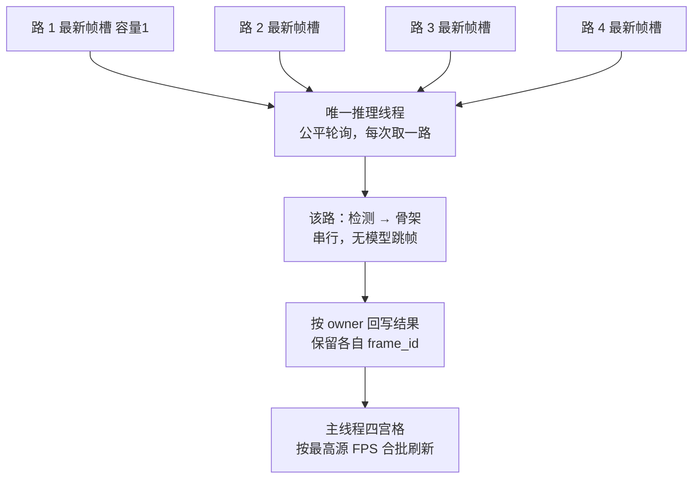
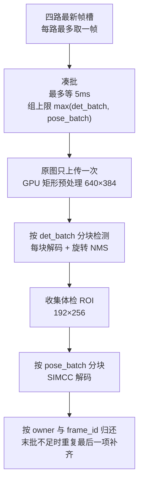
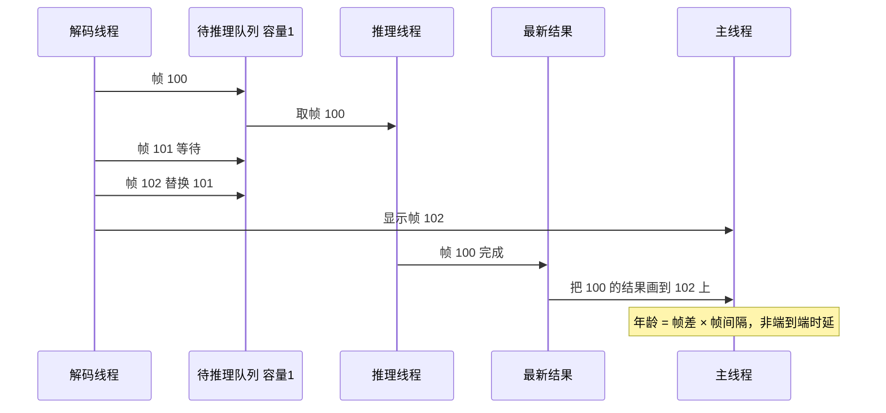

# 代码地图与流程图

> 面向接手者的第一份文档：这个仓库由哪些文件构成、每个可执行目标怎么被编出来、一帧数据怎么流过它。
> 修改代码时请同步更新本文件和对应轮次的报告，避免文档与实现再次分叉。

- 目标设备：**Jetson Xavier NX Developer Kit**（Compute Capability 7.2 / 6 SM / 可见显存 6848 MiB）
- 软件：JetPack 5.1.1、CUDA 11.4、TensorRT 8.5.2、OpenCV 4.5.4、C++17
- 代码量：`cpp_infer/src` 约 2900 行，按职责分 7 个模块（`core/` `capture/` `preprocess/` `models/` `pipeline/` `probes/` `config/`），其中 `core/main.cpp` 约 520 行、`probes/dual_probe.cpp` 438 行、`probes/batch_probe.cpp` 338 行

## 1. 模块划分

`src/` 按职责分模块，每个目录只放一类文件：

| 目录 | 关键文件 | 一句话职责 |
|---|---|---|
| `core/` | `main.cpp`、`bounded_queue.hpp`、`profile_timing.hpp` | 引擎封装、单图前后处理、绘制、队列、计时——所有探针共享的基础 |
| `capture/` | `hardware_capture.hpp` | 硬解出 I420，转 BGR，读色彩元数据；ocv 软解回退 |
| `preprocess/` | `accel_preprocess.cu`、`batch_kernels.cu`、`stage2_kernels.cu`、`stage2_io.hpp` | GPU 预处理 kernel：letterbox、pose warp、I420→BGR、pinned 复用 |
| `models/` | `joint_detector.hpp`、`batch_decode.hpp`、`batch_model.inc`、`stage2_model.inc` | 模型专属后处理：4 类 OBB 解码、旋转 NMS、SimCC、批量 IO |
| `pipeline/` | `pipeline.hpp`、`batch_runner.hpp` | 调度：四种单路模式、多路轮询、批量凑批 |
| `probes/` | 5 个 `*_probe.cpp` + `dual_probe.cpp` | 每个文件对应一个可执行目标（共 6 个入口目标） |
| `config/` | `batch_args.hpp`、`yaml_loader.hpp` | `batch_probe` 专属参数系统（位置参数 / preset / 命令行覆盖） |
| `src/` 根 | `silu_plugin.cu` | 自定义 SiLU 插件，独立编成 `.so` |

| 横切关注点 | 位置 | 说明 |
|---|---|---|
| 观测与验收 | `core/profile_timing.hpp`、`--metrics` CSV、200 ms 规则、CTest | 分阶段计时与可复核的吞吐/年龄指标 |
| 构建 | `CMakeLists.txt`、`cmake/accel.cmake`、`cmake/stage2.cmake`、`.gitignore` | 目标划分、开关、忽略规则 |

## 2. 三个模型与两种链路

| 链路 | 检测 | 人体 | 骨架 | 入口 |
|---|---|---|---|---|
| 三模型（旧） | YOLO-OBB 640×640，3 类 | YOLOX-tiny 416×416 | RTMW 192×256 | `sop_nx_infer`、`sop_nx_dual_probe`、`sop_nx_stage2_probe` |
| 两模型（新） | 联合 OBB 640×640 或 640×384，4 类 | 由联合 OBB 的 person 类给出 | 同一份 RTMW 引擎 | `sop_nx_joint_probe`、`sop_nx_accel_probe`、`sop_nx_profile_probe`、`sop_nx_batch_probe` |

两模型的差别只有一处：**联合 OBB 多一个 person 类，省掉 YOLOX 这一次前向**；RTMW 权重、裁剪规则、SimCC 解码完全复用。因此骨架质量受人体框变化影响，必须单独验收。

联合 OBB 引擎依赖自写 SiLU 插件 `build/libsop_silu_plugin.so`（替换 93 组 `x*sigmoid(x)`），**plan 与 so 必须一起部署**，只拷 `.plan` 会因反序列化找不到插件而失败。

## 3. 编译期包含关系（最容易看错的地方）

这个工程没有把推理实现拆成库，而是用**宏 + 直接 include `.cpp`** 复用到 7 个可执行文件（`sop_nx_infer` 直接编 `core/main.cpp`，其余 6 个入口 include 它）。看懂这张图，就不会误以为 `joint_probe.cpp` 只有 3 行是残缺代码。

`SOP_INFER_EMBEDDED` 的作用是关掉 `main.cpp` 末尾的 `main()`，改由 `dual_probe.cpp` 提供唯一入口。**因此 `joint_probe.cpp` / `accel_probe.cpp` / `stage2_probe.cpp` / `profile_probe.cpp` 实际共享同一份 `dualProbe()` 实现，靠宏切换模型与预处理路径。**

## 4. 可执行目标与宏矩阵

| 目标 | 源文件 | 关键宏 | 构建开关 |
|---|---|---|---|
| `sop_nx_infer` | `core/main.cpp` | 无 | 默认 |
| `sop_nx_dual_probe` | `probes/dual_probe.cpp` | `SOP_INFER_EMBEDDED` | 默认 |
| `sop_nx_joint_probe` | `probes/joint_probe.cpp` | + `SOP_JOINT_DETECTOR` | 默认 |
| `sop_nx_accel_probe` | `probes/accel_probe.cpp` | + `SOP_ACCEL` | `-DSOP_BUILD_ACCEL=ON` |
| `sop_nx_stage2_probe` | `probes/stage2_probe.cpp` | + `SOP_STAGE2` | `-DSOP_BUILD_ACCEL=ON` |
| `sop_nx_profile_probe` | `probes/profile_probe.cpp` | + `SOP_PROFILE` | `-DSOP_BUILD_ACCEL=ON` |
| `sop_nx_batch_probe` | `probes/batch_probe.cpp` | + `SOP_BATCH` | `-DSOP_BUILD_ACCEL=ON` |
| `libsop_silu_plugin.so` | `silu_plugin.cu` | — | 默认 |
| `sop_stage2_kernels` / `sop_batch_preprocess` / `sop_preprocess` | 三个 `.cu` | — | `SOP_BUILD_ACCEL=ON` |

`SOP_BUILD_ACCEL=ON` 会额外要求 `libavformat` / `libavutil` / `libswscale`（通过 pkg-config），默认构建不需要这些。

测试目标：`silu_plugin_test`、`pipeline_queue_test`、`stage2_test`、`accel_preprocess_test`、`accel_model_test`、`accel_decode_test`、`batch_preprocess_test`。当前 5 项注册进 CTest。

## 5. 单路流水线（`--mode parallel`）

五类模式的区别只在调度：`legacy` 逐帧串行；`serial` 同 `legacy` 但带测量；`pipeline` 三段有界队列、三模型仍串行；`parallel` 再让 OBB 与「人体→骨架」两条分支并行。不带 `--realtime` 时按帧编号等待结果，不丢帧，用于可重复对比。

## 6. 四路共享串行

一次启动只有一个推理线程，因此**四路各有 1/4 左右的机时**。忙碌时只替换「尚未开始」的任务，不排队堆积；队列永不增长是设计前提，不是遗漏。

## 7. 批量调度（`sop_nx_batch_probe`，当前最快）

固定 batch 引擎遇到末批不足会用**最后一个真实项补齐**，只回写真实项；补齐的计算与等待计入实际耗时。`actual_batch` 记录的是引擎调用批量，可能含补齐项，不能直接当真实帧数。

## 8. 一帧的时间语义

两个经常被误读的指标：

- **窗口 FPS** 是预览消费率，`--preview-first` 能让它变高但不增加识别次数。
- **结果年龄** 由源帧编号差换算，量化步长约 40ms（25fps）；不含远程桌面传输与屏幕呈现。

## 9. 关键常量

| 项 | 值 | 位置 |
|---|---|---|
| OBB 输入 | 640×640 居中补边；矩形版 640×384，内容 640×360，上下各 12 | `models/joint_detector.hpp`、`models/batch_model.inc` |
| OBB 阈值 / NMS | 置信度 0.25；每类旋转 IoU 0.55；候选上限 300 | `yoloDetections()` |
| YOLOX 输入 | 416×416，右下填充；person 阈值 0.3 | `yoloXPeople()` |
| 人体框扩张 | 1.25 倍，按 0.75 宽高比仿射裁剪 | `rtmwPose()` |
| RTMW 输入 | 宽 192 × 高 256，133 点 | `rtmwPose()` |
| 结果过期 | 默认 200ms，`--max-result-age-ms` 可调 | `core/main.cpp`、`probes/dual_probe.cpp` |
| 队列容量 | 预览/待推理各 1；固定帧模式 FIFO 各 2 | `core/bounded_queue.hpp` |
| 引擎默认路径 | `build/yolo.plan`、`build/yolox.plan`、`build/rtmw.plan` | `parseArgs()` |
| batch 引擎 | `models/batch_20261020/obb_640x384_b1_4.plan`（动态 profile min1/opt2/max4） `models/batch_20261020/rtmw_b4.plan`、`rtmw_b2.plan`；pose_batch=1 时用 `build/rtmw.plan` | `config/batch_args.hpp` |

## 10. 工程上的坑（都踩过）

| 坑 | 现象 | 处理 |
|---|---|---|
| TensorRT 8.5.2 会在 TopK 后处理节点失败 | 原始 end-to-end ONNX 建引擎报错 | 用截断到 `[1,8400,8]` 的 raw 图，top-k 与旋转 NMS 交给 C++ |
| Xavier 上启发式策略搜索失效 | 联合 OBB 全候选构建 23 分钟不结束 | 用 SiLU 插件替换 93 组激活，把构建压到可接受时间 |
| plan 与插件分家 | 换机器只拷 `.plan`，反序列化报找不到插件 | `libsop_silu_plugin.so` 与 plan 一起部署，`silu_plugin.cu` 编出 sm72 + PTX |
| SSH 启动无窗口 | 报 `No accessible local GNOME desktop found` | 先在 NX 登录桌面，或显式 `DISPLAY=:0 XAUTHORITY=/run/user/1000/gdm/Xauthority`，或 `--headless` |
| `.inc` 与嵌入 `.cpp` 的编译期耦合 | 改 `core/main.cpp` 会同时影响 6 个目标，头文件缺失只在特定宏组合下暴露 | 每次改动后至少编译默认目标 + `-DSOP_BUILD_ACCEL=ON` 全套 |
| `cmake/include()` 的基准目录 | `cmake/accel.cmake` 里写 `include(stage2.cmake)` 报找不到文件 | `include()` 相对**顶层 `CMakeLists.txt`** 解析，必须写 `include(cmake/stage2.cmake)` |
| `--model-dir` 相对当前目录 | 从 `build/` 启动却写 `--model-dir models`，报 `Cannot open TensorRT engine` | 程序约定从 `build/` 启动，写 `--model-dir ../models`；`scripts/run.sh` 已封装 |
| 文件行尾 | 曾经出现 CRLF 混入源文件，被单独一次提交修正 | 提交前用 `git diff --check` 与实际 diff 复核 |

## 11. 已知未实现

真实 RTSP 接入与断流重连、多人骨架输出（只保留最佳单人）、跟踪与平滑、运动补偿、INT8 量化、CUDA Graph 进应用、单进程多路作为产品功能、TCN 时序判定、MQTT 对接与 SOP 状态机。以上均在报告中标注为「未实现」，不要在汇报里当作已有能力。

## 12. 维护约定

1. 新增实验入口时：`probes/xxx_probe.cpp` + `#define SOP_XXX` + `include`，并在 `CMakeLists.txt` 或 `cmake/stage2.cmake` 里新增目标，**默认不替换旧目标**。
2. 改模型/阈值/尺寸：同步更新第 9 节与本轮报告，并说明是否影响结果一致性。
3. 性能数字一律标注设备、输入、时长、预热窗口与是否有画面，禁止把窗口 FPS 当识别 Hz。
4. 提交前核对 `git status` 与 `git diff --cached --stat`，确认视频、权重、plan、build、output 未被暂存。
5. 新增运行参数时：先判断它属于 `BatchArgs`（`batch_probe` 专用）还是 `Args`（`core/main.cpp` 共用），不要把 `batch_probe` 的参数塞进共用结构体。

