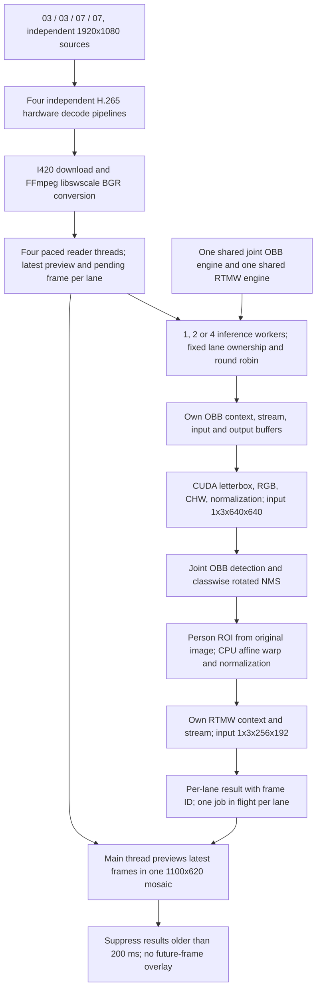

# Four-stream acceleration experiment

Target device verified from device tree: **Jetson Xavier NX**, JetPack 5.1.1,
CUDA 11.4, TensorRT 8.5.2.2, OpenCV 4.5.4. These are not Orin NX measurements.

## Architecture



Two workers own lanes 0/2 and 1/3 respectively. Four workers own one lane each.
Engine weights and their runtime lifetime are shared. Execution contexts, CUDA
streams, GPU source storage and inference buffers are never shared between
workers. The OBB-to-RTMW dependency stays sequential inside a job. There is no
batch-4 engine, tracking, smoothing, RTMW GPU preprocessing, or zero-copy capture.

## Build and run

Existing installed FFmpeg development libraries are used by the accelerated
target for color metadata and YUV conversion. Hardware decoding uses OpenCV's
existing GStreamer backend. No package installation.

```bash
cd /home/nvidia/Music/project/sop_Monitor
cmake -S . -B build -DSOP_BUILD_ACCEL=ON
cmake --build build -j2
(cd build && ctest --output-on-failure)
./build/sop_nx_accel_probe \
  --source ../test_vedio/03.mp4 --second-source ../test_vedio/03.mp4 \
  --third-source ../test_vedio/07.mp4 --fourth-source ../test_vedio/07.mp4 \
  --duration 300 --workers 1 --decoder gst-h265 --preprocess cuda
```

The acceleration targets require `-DSOP_BUILD_ACCEL=ON`; the default build does
not require these extra media development libraries. `--workers 1|2|4` must not
exceed lane count. Use `--single-source --workers 1`
for one video. Defaults apply only to this new executable: 1 worker, hardware
H.265 decode, CUDA OBB preprocessing. One worker performed better than two/four
in this device's four-stream tests; concurrency remains available for experiments.
Use `--headless` to exclude GUI cost, `--metrics PATH.csv` for per-lane observations.
Press Q or Escape to stop the mosaic. The time limit includes the first five
seconds, which are excluded from the logged steady inference rate.

Baseline rollback without replacing any files:

```bash
./build/sop_nx_joint_probe \
  --source ../test_vedio/03.mp4 --second-source ../test_vedio/03.mp4 \
  --third-source ../test_vedio/07.mp4 --fourth-source ../test_vedio/07.mp4 \
  --duration 300
```

For isolated controls, accelerated target also accepts `--decoder opencv`,
`--preprocess cpu`, `--workers 1`. There is no silent hardware-decode fallback.

## Image and color correctness

The original full-resolution image is retained for person crops and display.
Only the OBB tensor is letterboxed to 640x640. RTMW retains its original 192x256
crop transform. Preview shrinking does not shrink the source used for inference.

An initial BGRx hardware conversion produced a large color difference and was
rejected. I420 through videoconvert also exceeded the person-box comparison
threshold. The final pipeline downloads native I420 and uses FFmpeg libswscale
with the same bicubic/color settings as the existing FFmpeg decoding path.
For local files, original FFmpeg stream color metadata selects the matrix and
range; unspecified SDR matrix uses BT.601 to match the existing FFmpeg path.
BT.709 and BT.2020 non-constant-luminance tags are recognized. Other matrices
fail explicitly; use OpenCV as a control. HDR tone mapping has not been added or
validated. For the two untagged SDR test files, native I420/libswscale was checked
against FFmpeg for 61 consecutive frames per source. This does not establish
pixel equivalence for other formats, tags or camera streams.

CUDA preprocessing uses integer letterbox geometry matching the existing CPU
path, honors non-contiguous source rows, quantizes resized RGB to 8-bit before
normalization, and supports FP32/FP16 model input. Odd input sizes can differ by
one 8-bit interpolation level from OpenCV; numerical tests cover that bound.

## Validation and scope

`accel_preprocess_test` checks landscape, portrait, odd dimensions, a one-pixel
image, non-contiguous strides and FP32/FP16 tensors. `accel_model_test ENGINE
IMAGE...` checks CPU/CUDA detections, then simultaneous independent contexts.
`--decode-pairs` before image arguments additionally compares CPU/hardware pairs.

```bash
python3 benchmark_accel.py --phase headless --duration 30
python3 benchmark_accel.py --phase gui --duration 30
python3 benchmark_accel.py --phase soak --duration 120 --workers 1
```

The Python script is an offline experiment driver and metrics collector. Decode,
inference, postprocessing and display execute in C++. The same unchanged model
engines are used in all comparisons. System RAM readings include the desktop and
other services; they are not per-process GPU memory figures.

The H.265 path is tested from the beginning of the two MP4 files. Hardware seeking
failed in this OpenCV/GStreamer combination; nonzero `--start-sec` is rejected
before starting hardware capture. Use `--decoder opencv` when seeking is needed.
The old executable's seeking behavior is retained. It contains an RTSP/H.265 branch
with TCP, a 100 ms jitter buffer and dropping old appsink frames. Real-camera
reconnection, network fault recovery, other codecs, RTSP color negotiation and
end-to-end camera timestamps are not validated by file playback. File frame-age
statistics must not be represented as actual camera-to-screen latency. Application
frame queues are bounded; this does not bound every codec/RTSP internal buffer.
The experimental RTSP branch currently assumes BT.709 limited-range input; camera
color metadata support must be completed before treating it as a generic camera
receiver. It is not a verified four-camera deployment.

The prior joint TensorRT model's ONNX confidence discrepancy remains a separate
known issue; this work does not establish model accuracy against ground truth.

## Source rollback

A persistent copy is also stored in `output/accel_20261019/before/`.
Before this work, `main.cpp`, `dual_probe.cpp`, `joint_detector.hpp` and
`CMakeLists.txt` were copied to `/tmp/sop-accel-before-20261019/` on the NX. They
include the user's earlier uncommitted two-model work. Restore only those four
files and rebuild to remove this round's integration; do not reset or discard
the entire Git workspace. New acceleration files can remain unused. Model plans,
videos, previous binaries' interfaces and older reports were not removed.
