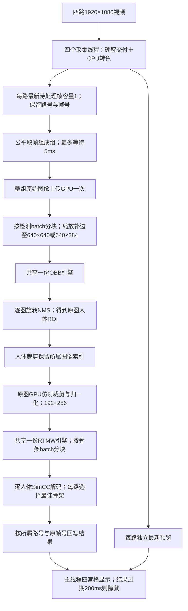

# 矩形输入与跨工位batch实验

这是独立实验入口，不替代 `sop_nx_stage2_probe`。模型权重不重新训练，视频和原引擎保留。

## 输入与模型

- 原始图像仍为1920×1080。OBB640×384时，完整内容为640×360，上下各12像素填充；640×640时上下各140像素填充。
- RTMW仍从原始图像的人体ROI裁剪，宽192、高256。
- RTMW裁剪由person框提供；OBB的hand框不直接决定手骨架是否输出，因此手框数量变化与骨架变化分别统计。
- OBB保留训练好的one-to-one分支，截取TopK前的候选，沿用原C++旋转NMS。
- OBB实验引擎为batch1..4、opt batch2的单一优化profile；固定空间尺寸分别生成两个引擎。不同batch在同一OBB引擎内比较，不等于分别专门调优后的极限性能。
- RTMW动态profile构建耗时过长，改为固定batch2/4的独立引擎；batch1继续使用原引擎。权重和算子不变，保留原生激活，不增加插件。
- 引擎和大模型文件位于models/batch_20261020，由项目忽略规则排除；不要提交权重、plan或视频。

## 启动四路

```bash
cd /home/nvidia/Music/project/sop_Monitor
./build/sop_nx_batch_probe \
  --source ../test_vedio/03.mp4 \
  --second-source ../test_vedio/03.mp4 \
  --third-source ../test_vedio/07.mp4 \
  --fourth-source ../test_vedio/07.mp4 \
  --det-height 384 --det-batch 4 --pose-batch 4 \
  --batch-wait-ms 5 --duration 60
```

该命令以对应引擎成功构建为前提。改 `--det-height 640` 测方形；改 `--det-batch` 和 `--pose-batch` 分别比较1/2/4。
加 `--headless` 关闭窗口。输入尺寸仅支持宽640、高384或640，不拉伸原图。

## 线程、队列和结果

- 一个进程、四个采集线程、一个批量推理线程、主线程显示，模型权重各加载一份。
- 每路独立最新待处理帧槽，容量1，繁忙时替换旧的待处理帧，防止队列积压。
- 每组最多取每路一帧，组大小上限为两个batch设置的较大值；不足时最多等待5ms。固定batch引擎遇到末批不足时重复最后一项补齐，只回写真实输入的结果，补齐计算计入实际耗时。
- 同组原图只上传一次，按detector batch分块检测。人体裁剪收集后按pose batch分块推理。
- 每个人体裁剪保留对应组内索引；骨架按原路号和帧号归还，仍沿用最佳单人选择规则。
- 输出actual_batch计数表示真实引擎调用批量，可能含上述补齐项；完成任务数和pose_calls只计真实帧/人体，不能把补齐、窗口刷新或重复显示算成新模型识别。
- 保留200ms结果过期保护、未来帧结果过滤；没有加入跟踪、平滑、插值。

## 固定帧检查



RTMW固定batch的末批不足时在推理前补齐，解码与回写只处理真实人体。显示缩小不改变上述算法源图和模型输入。

```bash
mkdir -p output/my_batch_validation
./build/sop_nx_batch_probe --duration 30 --headless \
  --det-height 384 --det-batch 4 --pose-batch 4 \
  --sample-dir output/batch_20261020/samples \
  --validation-dir output/my_batch_validation
```

固定样本包括03/07的0、30、60、300、600、900帧，共12张。各方案使用同一份PNG。
输出检测框、全部骨架点、元数据CSV和960×540叠画；`scripts/analysis/analyze_batch.py`分别报告与legacy及square11的差异。
这些是与当前模型输出的对照，没有标注真值，不能用来证明准确率提高。

## 测试、日志和回退

metrics.csv的检测/骨架耗时按组内真实帧数均摊；它们是单位工作成本。整组推理延迟与阶段总耗时查看groups.csv，不把均摊成本当成单张图独立完成延迟。

```bash
cd /home/nvidia/Music/project/sop_Monitor/build
ctest --output-on-failure
```

新预处理测试比较FP32/FP16下的新旧方形输入、矩形中间内容和批内偏移；是否通过以实际日志为准。
完整实验命令与退出码保存在output/batch_20261020/manifest.json。运行`scripts/analysis/batch_experiments.py`会执行构建、测试并覆盖同名实验日志，重跑前应另存已有结果。

本轮对原文件的改动只有main.cpp中受SOP_BATCH保护的include和stage2.cmake的新目标。
原文件备份位于output/batch_20261020/before；恢复前检查后续修改，只撤销本轮diff并重编译，不覆盖前一轮计时修改或用户原有.gitignore。
