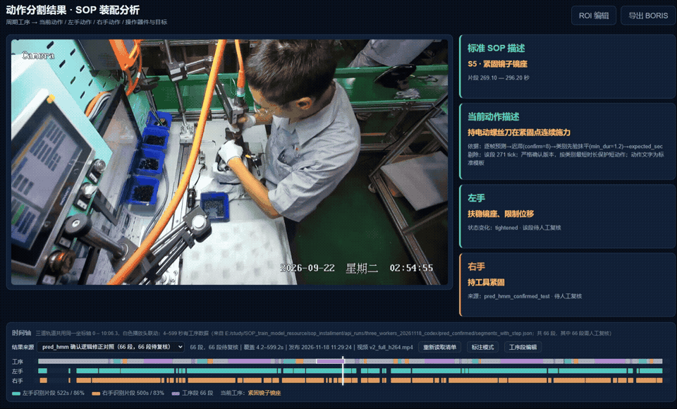

<div align="center">

# SOP 装配步骤分析

**从工位视频到步骤片段、时间轴与同步回放**

`Python · RTMW · MLP + HMM · Vue 3`

[技术实现方案](docs/TECHNICAL_IMPLEMENTATION.md) · [文档导航](docs/README.md) · [完整效果录屏](docs/media/sop-demo.mp4)

</div>

[](docs/media/sop-demo.mp4)

> 用户提供的约 66 秒效果录屏，动图展示其中 8 秒；画面选中的是严格确认对照 `pred_hmm_confirmed_test`（66段）。当前默认推荐结果为 **`pred_hmm_full`**：65 段，24 段标记待复核。这是离线分析后的同步回放，尚未验证在线实时 SOP 识别。

## 当前主线

```text
人工 SOP / 周期标注 ──────────────────┐
工位视频 → 人体检测 + RTMW → 153维骨架特征 → MLP 帧分类
                                      ↓
                      HMM / Viterbi 整周期解码
                                      ↓
                0.1秒时间栅格 → 短段处理 → 时长先验 → 同类合并
                                      ↓
                    步骤查表 + 本地描述模板 → JSON → 网页回放
```

保留原六步：取镜座、取上盖、装上盖、装密封塞、紧固、系扎带；另有循环外停留与准备。当前推荐结果的运行时链路不调用大模型。Qwen3-VL 的自由发现、细分和三工人归纳作为独立实验保留，未替代这条基线。

| 核查项 | 当前结果 | 适用范围 |
|---|---:|---|
| 帧级准确率 | 88.62% | 已存预测文件的七周期留一验证；同一视频、人工周期及 invalid 屏蔽 |
| GT 步骤命中 | 27 / 37，73.0% | 同类、IoU ≥ 0.3，一对一匹配，排除 nested_short |
| 边界误差中位数 | 0.30 秒 | 已存分段与本视频 GT；±1.5 秒召回 86.5% |
| 跨工人 / 新机位 / 在线识别 | 未验证 | 不将当前数字外推为生产准确率 |

左右手与工具描述目前按步骤模板填写，并非每段独立识别。S2 仅命中 1/7，S6 为 0/1，仍需改进。严格确认试验另存为 `pred_hmm_confirmed_test`，默认基线保持不变。

## 本地查看

进入本目录后执行；只看已有结果不需要 Python、模型权重或 API Key。

```powershell
cd web
npm ci
npm run dev
```

打开 [SOP 检测页](http://127.0.0.1:5173/?run=pred_hmm_full)。端口被占用时显式指定 `npm run dev -- --port 5174`；请通过 HTTP 打开页面。

**媒体准备：**源视频不入 Git。将与当前 GT 同一时间原点的完整基线源视频（本地为 `vedio/side3.mp4`，与 `web/public/video/v2_full.mp4` 的 SHA256 一致） 转成浏览器可播放的 H.264 文件，放到 `web/public/video/v2_full_h264.mp4`。仓库含步骤和姿态结果；缺视频时仍能读到步骤，但不能播放。示例（需要已安装 ffmpeg，不会自动下载）：

```powershell
ffmpeg -i vedio/side3.mp4 -c:v libx264 -crf 23 -pix_fmt yuv420p -an -movflags +faststart web/public/video/v2_full_h264.mp4
```

历史 run 使用各自的原始视频，不能只改文件名冒充对应输入。重复动作核对页的裁片属于可再生成素材，保留索引；配置本地源视频后可用 [裁片重建脚本](scripts/restore_review_clips.py) 恢复，详见技术文档。

## 代码导航

| 目录 / 入口 | 职责 |
|---|---|
| `api_teacher/run_local_pose.py` | 人体检测、RTMW 身体与双手关键点 |
| `scripts/pose_features_v3.py` | 51 维基础特征及两组差分，共 153 维 |
| `scripts/hmm_dtw_baseline.py` | 留一周期训练、MLP / HMM / DTW 对比、预测导出 |
| `scripts/build_segments_from_pred.py` | 从帧标签生成步骤时间段，保留可选严格迟滞试验 |
| `scripts/enrich_segments.py` | 本地模板或可选 Qwen 语义补充 |
| `scripts/publish_segments.py` | 发布 run JSON、结果清单和默认数据 |
| `web/` | 视频、步骤卡片、时间轴、人工编辑及 BORIS 导出 |
| `configs/` | SOP 表与机位 ROI；更换机位需要重新校准 |
| `docs/` | 当前实现、实测口径及历史实验记录 |
| `tests/` | 现有紧固事件计数测试 |

原始媒体、ONNX / MediaPipe 权重、虚拟环境、`api_runs/` 运行缓存与备份保留在本地，忽略规则阻止误提交。历史结论按实验时间阅读，**当前链路以技术实现方案为准**。

## 下一步优化

沿用 MLP + HMM 主线，优先检查 S2 / S6 错例、关键点缺失、时长先验和标注边界。相机减少遮挡可能有帮助，但仍需重标 ROI 并验证分布变化。部署前需要保存最终模型及归一化参数，核查转移矩阵统计顺序，并改造整段 Viterbi 为有明确延迟的在线解码；当前未完成这些部署步骤。
