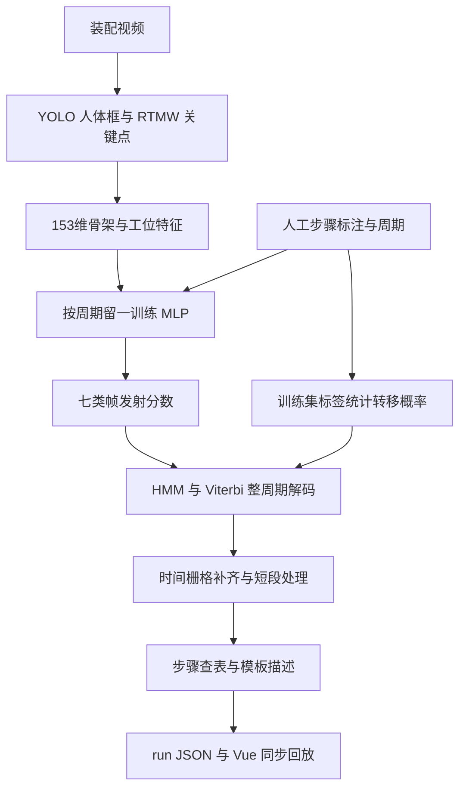

# SOP 装配步骤分析：技术实现方案

核查日期：2026-11-18。适用结果：`pred_hmm_full`。本文以当前源码、已存预测和段级复测为依据，区分演示结果、训练验证和待实现部署能力。

## 1. 目标与交付边界

输入固定工位装配视频，输出每个 SOP 步骤的起止时间、标准名称、待复核标记，并在网页中随视频播放切换。手、工具和描述是辅助展示。当前交付为离线分析和同步回放，未实现经过验证的在线 SOP 推理服务。

原六步表位于 `configs/sop_steps.json`；六步名称固定，识别器输出类别，页面不让大模型临时改名。`idle_auxiliary` 在发布时映射为 `idle`。自由归纳的三工人词表仅属于独立实验，不与六步指标混用。

## 2. 为什么当前画面能稳定对应步骤



稳定性来自监督学习的类别信息、整周期时序解码和片段后处理。网页只是读取已生成的时间段，不能把播放时的流畅程度当作现场推理速度。平滑也可能持续保留误判。

### 2.1 视觉观测

`api_teacher/run_local_pose.py` 先检测人体，再以人体框运行 RTMW whole-body 133 点模型，保存身体和左右手关键点。当前提取脚本已支持低人体阈值和短时人体框兜底；兜底增加覆盖不等于关键点正确率提高。模型权重由使用者本地提供，不入库。

`scripts/pose_features_v3.py` 每 tick 构建 51 维基础特征，拼接 lag=3、lag=6 的差分形成 153 维。内容包括手相对人体的位置、展开程度、速度、双手距离、肩腕向量、肘角、身体方向及与工位 ROI 的距离。速度使用 10 Hz 假设；更换采样率须核对。固定工位距离特征使模型对机位和 ROI 有依赖。

当前缺失处理把零值视作缺失并逐列前向填充，没有最大填充间隔，还可能覆盖有意义的零值。它是待核查项，本文不把它描述成可靠的遮挡恢复算法。

### 2.2 分类与时序

`scripts/hmm_dtw_baseline.py` 的 `mlp_hmm` 分支执行：

1. 同视频七个周期轮流留一，其他周期为训练集；使用 GT 周期边界及 invalid 屏蔽。
2. 用训练集计算均值、标准差，标准化输入。
3. MLP：153 → 64 → 64 → 7，ReLU、Dropout=0.2，加权交叉熵，Adam，默认 300 epoch。
4. 训练集标签统计带平滑的转移矩阵；对测试周期整段做 Viterbi。
5. 汇总各留出周期预测为 `pred_mlp_hmm.json`。

该结果是多个留一模型预测的拼接，不是一个已经导出的生产模型。当前脚本没有保存最终 MLP checkpoint、归一化参数和版本化转移矩阵。

`trans_matrix()` 以 `np.argsort(cyc_tr)` 排序，未显式保证周期内时间稳定，也未在每个周期间重置前态；屏蔽帧间被当作连续。部署前必须核查这些转移计数，修订后重新评测。当前整理不悄悄重训或替换用户认可的结果。

### 2.3 从帧到步骤段

`scripts/build_segments_from_pred.py` 将有效预测按最近帧补到 0.1 秒栅格，再执行迟滞、类别相关短段吸收、`expected_sec` 时长筛选和相邻同类合并。原基线 `confirm=8`、`min_dur=1.2`。

原 `hysteresis()` 存在未确认标签仍留在输出的问题，因此不能宣称原路径严格实现“连续八帧才切换”。可选 `--strict-hysteresis` 修正确认行为并保护短类，试验独立保留，默认关闭。两者都可能将缺失区间填成确定步骤，后续应增加不可判定/缺失标记。

时长先验不是产品完工证据。短动作、返工、顺序变化不应仅靠规则强制改成正常流程。当前 HMM 是软转移约束，也没有可靠的工件身份跟踪。

### 2.4 模板、发布和前端

`scripts/enrich_segments.py --provider local` 根据 `step_id` 填写动作、左右手和状态变化模板，零 API 调用。模板没有独立验证每段手物交互。Qwen 分支是可选实验，不参与当前基线的步骤生成。

`scripts/publish_segments.py` 写入 `web/public/data/runs/<name>.json`、`runs/index.json`、默认 `segments.json` 与 `segments_meta.json`。前端 `web/src/App.vue` 按 `video.currentTime` 选择步骤，绘制时间轴并支持编辑和 BORIS 导出。

关键 run 字段：`video` 为 `public/video/` 下文件名，`pose` 为 `public/data/` 下姿态文件，`station` 对应 `configs/stations.json`；`steps` 包含 `start/end/step_id/name/action/left_hand/right_hand/need_review` 等。已有字段保持兼容。`confidence=null` 不代表高置信度，`need_review=false` 也不等于正确。

## 3. 当前结果及其统计口径

| 项目 | 原 `pred_hmm_full` | 严格确认对照 |
|---|---:|---:|
| 发布段数 | 65 | 66 |
| 同类 IoU≥0.3 命中 | 27/37，73.0% | 28/37，75.7% |
| 命中段 IoU 中位数 | 0.887 | 0.81 |
| 边界召回，±1.5秒 | 86.5% | 85.1% |
| 边界精确，±1.5秒 | 87.9% | 85.1% |
| 边界误差中位数 | 0.30秒 | 0.30秒 |

GT 排除 `nested_short`，按同类 IoU 贪心一对一匹配；边界统计由现有脚本按容差分别检查，并非一对一匹配。原基线逐类命中：S1 6/9、S2 1/7、S3 7/7、S4 7/7、S5 6/6、S6 0/1。严格确认提升一个短动作，但降低部分边界指标，所以未切换默认结果。

已存帧级预测报告 88.62%，5,174 个有效帧，时间 4.2–599.1 秒。这与段级 73.0% 是不同指标；本次整理复测段级，不把此前训练数字冒充本次重训结果。标注较少的类别表现差，也不能据此宣称“骨架85%天花板”或“任何大模型都做不到”。

实际播放视频约 599.09 秒；旧 run 的 duration=606.3 是历史元数据，末段到599.2。保留原时间段便于对照，时间轴尾部存在元数据差异，尚未重新对齐所有历史 run。

## 4. 运行与复现

以下命令从本项目目录执行。前端已执行生产构建；本次段级评测与基线后处理复现已执行。完整姿态提取和七折训练属于复现入口，本次整理未重新运行，不保证新硬件上数值逐位相同。

### 4.1 查看已有结果

先按主 README 准备 `web/public/video/v2_full_h264.mp4`，然后：

```powershell
cd web
npm ci
npm run dev
```

访问 `http://127.0.0.1:5173/?run=pred_hmm_full`。只看已有结果不需要 Key。ROI 和步骤写回接口只由 Vite dev server 提供，静态 `dist` 部署不含这些写回 API。

### 4.2 生成帧级预测（本次未重训）

Python 依赖见 `requirements.txt`。训练需要 PyTorch（通常由 ultralytics 带入），运行前自行确认匹配的平台环境。已有 GT、帧标签和 v3 姿态训练缓存保留在 `web/public/data/`。

```powershell
python scripts/hmm_dtw_baseline.py --pose web/public/data/local_pose_full_v2.json --labels web/public/data/frame_labels_full.json --methods mlp_hmm --save-pred api_runs/pred_mlp_hmm.json --out api_runs/mlp_hmm_metrics.json
```

### 4.3 由已有预测复现后处理

发布包在 `examples/pred_hmm_full/` 保留冻结预测、后处理和评测快照，不包含 Key 或模型权重。输出新目录，避免覆盖已认可结果。

```powershell
python scripts/build_segments_from_pred.py --pred examples/pred_hmm_full/pred_mlp_hmm.json --out api_runs/reproduced_segments --confirm 8 --min-dur 1.2
python scripts/eval_segments_per_class.py --proposal api_runs/reproduced_segments/segments_proposal.json --gt web/public/data/gt_segments.json --json-out api_runs/reproduced_eval.json
python scripts/enrich_segments.py --proposal api_runs/reproduced_segments/segments_proposal.json --out api_runs/reproduced_enriched --provider local
python scripts/publish_segments.py --from api_runs/reproduced_enriched --name reproduced_hmm --clip-offset 0 --duration 606.3 --video-name v2_full_h264.mp4 --pose local_pose_full_web.json --station ST01 --dry-run
```

确认后移除 `--dry-run` 才会发布并切换默认 run。不要同时启动相互覆盖同一输出路径的脚本。

### 4.4 可选：恢复实验核对页裁片

原始视频与批量派生媒体留在本地，不随仓库发布；核对页 HTML 和片段索引保留。重建只解码本地视频，**不会再次调用大模型**，不会替你重新判定类别。

```powershell
python scripts/restore_review_clips.py --ffmpeg ffmpeg --video side_1=vedio/v_3/side_1.mp4 --video side2=vedio/v_3/side2.mp4 --video side3=vedio/side3.mp4 --video v2=vedio/side3.mp4 --dry-run
```

核对源视频后去掉 `--dry-run`。输出按已有索引的原始帧号截取，保留画面时间水印；已存在文件跳过。旧 VLM 候选里有已知分类错误，不能用这些候选充当 GT。

## 5. 文件组织与发布策略

保留当前识别脚本、配置、训练/评估输入、已发布 run、必要的网页姿态和历史实验说明。原始视频、提取中间缓存、模型权重、生成裁片、环境与备份不入库；录屏只发布约66秒的压缩无声版本及8秒动图，原录屏原样留本地。录屏中选择的是严格确认对照 `pred_hmm_confirmed_test`（66段），项目默认仍为原65段基线，二者指标见上表。

本次仅将可验证无引用的旧机械10秒裁片、重复索引及空嵌套目录移出有效目录，留本地备份。Python缓存保留且忽略。旧实验文档按日期保留，不能把早期“上限”“定稿”等结论当成当前事实。清理记录见 `REPOSITORY_MAINTENANCE.md`。

远端 `sop_Monitor` 根目录是另一个 NX C++ 推理工程，本项目位于 `sop_offline_teacher/`。本地目录名 `sop_installment` 不改变远端既有路径。发布使用开发分支 `feat/roi-action` 的隔离检出，普通快进提交；根目录仅补充展示入口，不覆盖 NX 代码，也不推送 main。

## 6. 沿用主线的优化与部署验收

优先逐段检查 S2、S6、idle 与准备动作的业务边界，区分关键点缺失、类别错误和后处理吞段。相机调整应改善工件与手部可见度，但仍需重新校准 ROI，用独立视频验证，不能直接保证错误消失。

下一阶段应核查转移计数和缺失填充，保存最终 MLP / scaler / 类别表 / 转移矩阵，加入模型版本，再实现有延迟上限的在线解码。用整段新视频、跨周期、跨工人分别统计段级匹配、短类召回、边界误差、不可判定率、延迟及资源占用。NX 上只有检测/姿态模块的性能数字，不能当成本项目完整 SOP 链路性能。

每项优化另建 run，与冻结基线同口径对照。回退时恢复默认 `active=pred_hmm_full` 与其原 JSON，不删除对照数据，也不靠强制顺序把异常装配伪装成正常六步。
