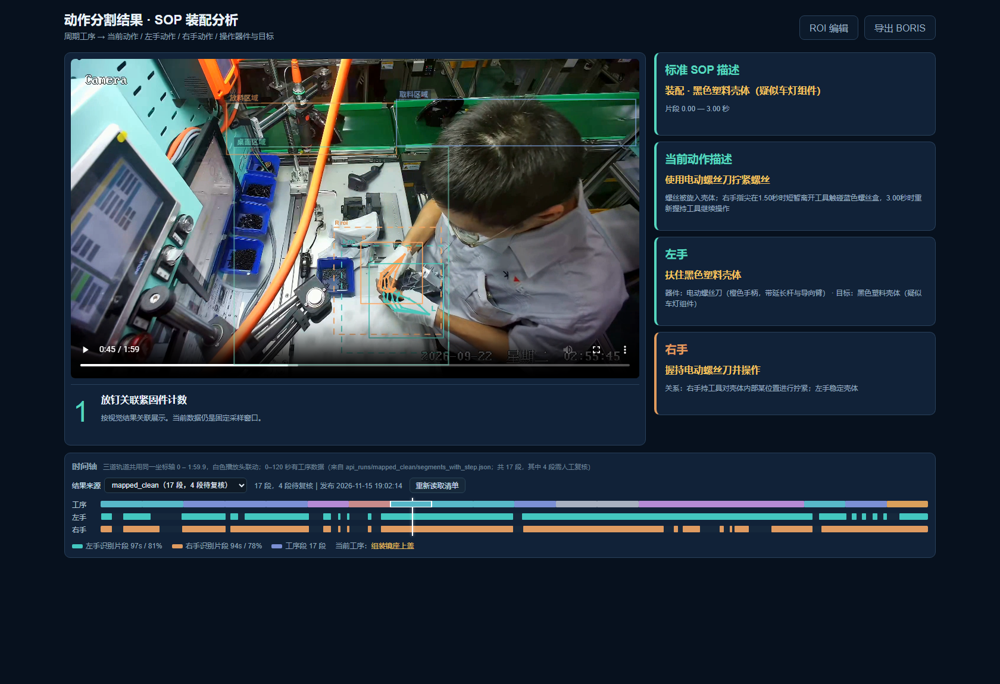
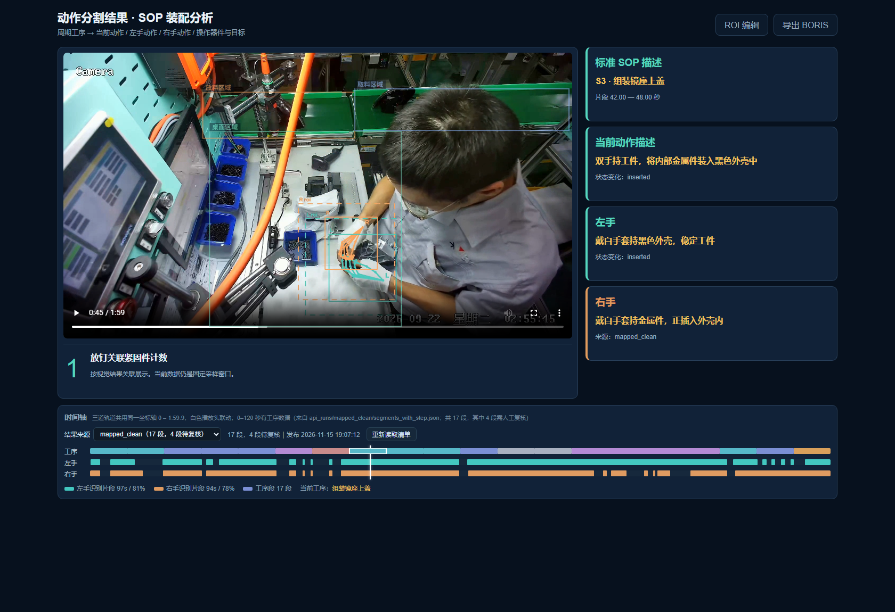

# 13 · 把你的 SOP 步骤和识别系统「联动」起来

> 读者：项目负责人。回答的问题：我有自己定义的 SOP 步骤，怎么让这套识别系统输出它们？
> 已实现：`configs/sop_steps.json`（步骤表）+ `scripts/map_to_sop.py`（转换器）。

---

## 一、先把「联动」拆成三件事（很多人卡在这里）

「联动」不是让模型理解你的 SOP，而是**三个数据结构对齐**：

```
① 步骤表（你定的）        configs/sop_steps.json      ← 唯一契约，7 个 step_id
        ↓ 教师/学生都只输出 step_id
② 识别输出                segments（带 step_id + 时间）
        ↓ 前端只认这个格式
③ 展示与训练              segments.json → 网页三轨 / 学生模型标签
```

**关键认知：模型永远不知道你的 SOP，它只知道你给它的 `step_id` 列表。**
所以"联动"的实质是：**把开放的文字描述，收敛到你的封闭步骤表上**。

---

## 二、两条联动路线，各有代价

| 路线 | 做法 | 优点 | 缺点 | 实测 |
|---|---|---|---|---|
| **A 闭集直选** | 提示词给 7 个 step_id，让模型直接选 | 输出天然对齐 | 词表窄 → 短动作几乎全错；命名口径受限 | 总体 0.408，装上盖 0% |
| **B 自由描述 + 映射**（本文件实现） | 模型自由写，程序把描述映射到 step_id | 保留描述能力，换产线只改映射表 | 映射表要按模型的实际用词维护 | 映射率 94%（严格）/ 100%（宽松） |
| **C 两段式（推荐）** | 先自由分段拿边界 → 再对每段做一次闭集分类 | 边界与命名各自用最合适的方法 | 两次调用，成本翻倍 | 未跑 |

---

## 三、已实现：步骤表 + 转换器

### 3.1 `configs/sop_steps.json`（契约）

每个步骤给 5 样东西：

```jsonc
{
  "step_id": "S3",
  "order": 3,
  "name_cn": "组装镜座上盖",
  "expected_sec": [5.0, 9.0],                    // 时长先验，可用于后处理
  "boris_behavior": "Assemble_the_mirror_base_cover",  // 与 BORIS 标注对齐用
  "aliases": ["组装上盖", "装上盖", "压合上盖"],      // 整串别名（辅助）
  "verbs_any": ["组装", "装入", "压合", "对位"],       // 动词维
  "objects_any": ["上盖", "盖板", "盖", "壳体", "外壳"], // 物件维
  "criteria": {"hand": "...", "object": "...", "tool": "..."}
}
```

**为什么要有 `verbs_any` + `objects_any` 两维**：实测只用整串别名，映射率只有 **11.8%**
——因为模型说"外壳/盖板/支架"，而 SOP 名写的是"镜座/上盖"。拆成两维后升到 **94~100%**。

### 3.2 `scripts/map_to_sop.py`（转换器）

```powershell
.venv\Scripts\python.exe scripts\map_to_sop.py `
  --proposal api_runs/free_clean/segments_proposal.json `
  --gt web/public/data/gt_segments.json `
  --out api_runs/mapped_clean --min-score 1.5
```

打分规则：

```
score = (命中任一动词 ? 1 : 0) + (命中任一物件 ? 1 : 0) + (命中整串别名 ? 0.5 : 0)
>= 1.5 → 接受为该 step_id
== 1.0 → 接受但标 need_review（只命中一维，多半判错）
< 1.0  → 若文本含"扫码枪/塑料袋/料盒"等无关物体 → idle；否则 unknown
```

产物：
- `segments_with_step.json`：每段带 `step_id / mapping_score / need_review`
- `mapping_report.md`：映射率、每段对照、与 GT 的一致率

---

## 四、实测（用你跑过的 free_clean 结果）

| 指标 | 严格（≥1.5） | 宽松（≥1.0） |
|---|---|---|
| 映射到 SOP 步骤 | **94.1%**（16/17） | 100%（17/17） |
| 需人工复核 | 4 段 | 3 段 |
| **与人工标注一致率** | **11.8%**（2/17） | 11.8% |

**这个结果必须讲清楚**：

> **映射层已经把格式问题解决了（94% 都能落到你的步骤表），
> 但一致率仍然只有 11.8%，因为「描述本身」就是错的** —— 模型把"取镜座"说成"外壳装入底座"，
> 映射器只能忠实映射错误描述。

**结论：联动机制 ≠ 识别能力。** 顺序必须是：

```
① 让描述正确（词表 + 问法 + 证据）   ← 当前卡在这
② 映射到 step_id（已完成，94%）
③ 人工复核 need_review 段
④ 用校对结果训学生模型
```

---

## 五、前端怎么接（✅ 已实现）

现在网页有时间轴上方的**「结果来源」下拉框**，每次跑完发布一下就能切着看，不用改页面代码。

```powershell
# 跑完教师后（两条命令任选其一）

# ① 跑的时候直接发布（一条命令到底）
.venv\Scripts\python.exe scripts\run_teacher_segments.py --src-mode clean `
  --video web/public/video/v2_5m_7m_pose.mp4 --clean-video vedio/v2.mp4 --clean-offset 300 `
  --duration 120 --stride 30 --frames 8 --out-offset 300 `
  --out api_runs/my_run --publish-name my_run

# ② 已经跑完了，只是发布（0 次 API 调用）
.venv\Scripts\python.exe scripts\publish_segments.py --from api_runs/mapped_clean --name mapped_clean
```

发布做了什么：

```
api_runs/<目录>/segments_with_step.json  （或 segments_proposal.json）
        ↓ 转成前端契约 + 把 v2 时间轴换成片段 0–120s
web/public/data/runs/<名字>.json      每次运行各存一份
web/public/data/runs/index.json       清单 → 网页据此生成下拉项
web/public/data/segments.json         同时设为"当前默认"（旧文件自动备份到 api_runs/_backup/）
```

网页上：

- 下拉框显示 `名字（N 段，M 段待复核）`
- 切换后工序轨立刻重绘：`mapped_clean` 显示 **S1~S6 的 SOP 名称**（组装镜座上盖 / 取镜座组件 / 紧固镜子镜座…），
  `free_clean` 显示模型的原始描述
- 右侧「结果来源」旁有「重新读取清单」按钮：跑完新结果不用刷新页面，点一下即可看到新条目

实测（Edge 无头浏览器 DOM 断言）：

| 项 | 结果 |
|---|---|
| 下拉项 | `free_clean（17 段）`、`mapped_clean（17 段，4 段待复核）` |
| 默认选中 | `mapped_clean` |
| 工序轨段数 | 17 |
| 切换后 | 正常重绘，标题变成原始描述 |
| 控制台报错 | 0 |

截图（时间轴上方「结果来源」、工序轨 17 段、图例显示「当前工序：组装镜座上盖」）：



> ⚠️ 已知不一致（下一步要修）：右侧四张卡片仍读旧的 `ablation_14_A.json`（0–30 s 的历史结果），
> 所以会出现「工序轨是新的 S3 组装镜座上盖，卡片却写"黑色塑料壳体（疑似车灯组件）"」。
> 修法：`publish_segments.py` 里把每个 step 的 `left_hand / right_hand / state_change` 一起写进
> `runs/<名>.json`，卡片改为从当前 run 取数据（约 30 行改动）。

### 5.1 卡片已接上同一个数据源（✅ 已修）

原来的问题是「两处数据源」：工序轨读发布结果，右侧卡片读 `ablation_14_A.json`（英文、旧数据）。
现在卡片优先用当前 run 的数据，只有没有发布结果时才回退到旧 ablation。



实测（t=45.4 s，Edge 无头 DOM 断言）：

| 卡片 | 内容 |
|---|---|
| 标准 SOP 描述 | `S3 · 组装镜座上盖`，片段 42.00 — 48.00 秒 |
| 当前动作描述 | `双手持工件，将内部金属件装入黑色外壳中`，状态变化：inserted |
| 左手 | `戴白手套持黑色外壳，稳定工件` |
| 右手 | `戴白手套持金属件，正插入外壳内`，来源：mapped_clean |

工序轨图例同时显示「当前工序：组装镜座上盖」——**三处一致**。

发布文件里为此新增了字段：`action / evidence / state_change / left_hand / right_hand / need_review`；
旧版运行结果缺左右手时，`publish_segments.py` 会从同目录（或 `source_proposal` 指向的目录）的
`windows_freeform.json` 按时间就近补全（实测补了 34 个字段）。

> 仍有一处未接：左下角「放钉关联紧固件计数」仍是旧 ablation 数据（`count` 计算依赖 `runItems`）。
> 它属于独立的小模块，需要时再接到 run 结果上。

---

## 六、方案 C（顺序约束解码）的实测与**一个被推翻的结论**

### 6.1 我先前给错了一个数字，必须更正

我一度报告「顺序解码把 GT 视角命中率从 30.8% 提到 **53.8%**」。**这个结论是错的。**

原因：早期的转移统计只统计「有标注的段」，`idle` 从不出现，于是解码器几乎不可能输出 idle，
它把每个 6 秒窗口都强行判成某个 SOP 步骤 —— 而 GT 的 13 段里恰好有不少是空隙，
于是「硬判」碰巧对上了几段，看上去像是提升。

### 6.2 修正后（把空隙也算成 idle 状态）的真实结果

| 输入 | gamma | GT 视角命中率（原始 → 解码） |
|---|---|---|
| 关键词分数 | 0.0 / 0.2 / 0.3 | 30.8% → 30.8%（无变化） |
| 关键词分数 | 0.5 | 30.8% → 15.4%（变差） |
| 关键词分数 | 0.8 | 30.8% → 15.4%（变差） |
| 方案 A 模拟输出 | 0.0~0.3 | 30.8% → 30.8%（无变化） |
| 方案 A 模拟输出 | 0.5 / 0.8 | 30.8% → 15.4% / 7.7%（明显变差） |

**结论：在当前数据条件下（固定 6 秒网格 + 描述与 GT 不符），顺序约束没有增益，权重过大反而更差。**

### 6.3 为什么不行（三个真实原因）

1. **段边界不对齐**：模型按 6 秒切，一个 GT 段常被 2 个模型段覆盖，取"第一个覆盖≥50%的段"本身噪声很大。
2. **观测分太"平"**：关键词只给 0 / 1 / 2 分；相邻步骤再给 0.6 倍余量后，各状态分差 < 1，
   而顺序项（gamma×logP）量级相当，于是顺序项把观测整体带偏。
3. **转移表被 idle 主导**：`idle→S4 ×6`、`S1→idle ×5`…… 因为 GT 标注段之间空隙很多，
   转移统计的一半是"进/出空闲"，顺序信息量被稀释。

### 6.4 所以方案 C 现在怎么定位

- **保留代码**（`scripts/sop_decode.py`），但**默认 `--prior-weight 0`、`--gamma` 建议 ≤0.3**，
  当作"以后能用的后处理工具"，**不要现在依赖它**。
- 它真正能发挥作用的场合是：**先把动作段检测准（边界对齐），再用顺序约束修相邻步混淆**。
  也就是等「切分」这一步做好之后再回来启用。
- 真正的瓶颈在别处：**观测质量**（模型能否正确判 step_id）和**段边界**（6 秒网格 vs 真实动作段）。

### 6.5 已交付的方案 A（等 API Key 即可验证）

`scripts/run_teacher_segments.py` 已改：

- 提示词里嵌入 `configs/sop_steps.json` 的**六步三要素判据 + 兜底类别**
- 输出新增 `step_id` 字段（只能取 S1~S6 / idle / unknown），并做**枚举校验 + 自动重试**
- 产物 `segments_proposal.json` 直接带 `step_id / step_name`（不再需要关键词映射）
- `--no-step` 可退回纯自由描述模式；`--print-prompt` 可零成本查看完整提示词

```powershell
# 零成本：先看提示词对不对
.venv\Scripts\python.exe scripts\run_teacher_segments.py --print-prompt --start 330 --duration 30 --frames 8

# 花 10 次调用：验证「切分 + 步骤判定」是否比关键词映射强
.venv\Scripts\python.exe scripts\run_teacher_segments.py --src-mode clean `
  --video web/public/video/v2_5m_7m_pose.mp4 --clean-video vedio/v2.mp4 --clean-offset 300 `
  --start 30 --duration 30 --stride 30 --frames 8 --out-offset 300 `
  --out api_runs/runA_330 --publish-name runA_330
```

## 七、待你确认的三件事

1. **步骤表是否完整**：现在 6 个（S1~S6），其中 S6「系扎带」在全片只出现 1 次。
   还有别的步骤要加吗？（比如"扫码""自检""放回治具"）
2. **S6 是否属于每周期必做**：GT 里 7 个周期只有 1 次系扎带 → 应设为「可选步骤」还是「漏做」？
3. **`aliases` / `verbs_any` / `objects_any` 的用词**：我按当前模型的实际说法填的，
   你按车间口语再补几条会更稳（改 JSON 即可，不用改代码）。
