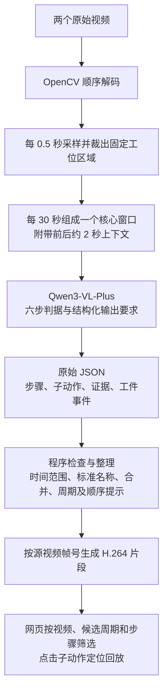

# 全片 SOP 识别实际实现与错误分析

实验运行于 2026-11-17，文档整理于 2026-11-18。本文对照本轮实际脚本、提示词、原始响应和发布数据编写，解释当前网页里的结果如何产生。

## 1. 当前方案的实际能力

当前实现使用 **定时抽帧、固定工位裁图、Qwen3-VL-Plus 提示词判定、规则整理、网页回放**。Qwen 同时生成 SOP 类别、时间边界、细动作、手物交互描述和工件切换事件。

这条流程已经能输出细粒度候选片段。步骤识别准确率尚未评测，用户反馈和已复核错例都表明类别与边界仍存在明显错误。

“固定六步”在代码中主要体现为给模型六步判据，以及根据返回的 step_id 查表显示标准名称。类别是否符合画面，仍取决于 Qwen 的视觉判断。

我之前对“顺序限制”的表述需要纠正。目前实现了回退、重复进入的提示及相邻同类合并，尚未实现强制顺序解码。候选周期依赖模型报告的工件事件。当前系统也没有通过视觉跟踪持续确认同一件工件的身份。

## 2. 从视频到网页的完整过程

本轮调用链直接读取视频像素。YOLO 人体检测、RTMW 手部骨架、物件检测器、接触检测器、学生模型均未接入这条实验链路。此前项目中的相关模块仍然存在，但这次识别没有调用它们。

## 3. 实际输入及抽帧方式

输入文件如下。

- [side_1.mp4](E:/study/SOP_train_model_resource/sop_installment/vedio/v_3/side_1.mp4)
- [v2.mp4](E:/study/SOP_train_model_resource/sop_installment/vedio/v2.mp4)

`run_full.py` 的 `prepare()` 顺序读取原视频，按 OpenCV 解码时间 `CAP_PROP_POS_MSEC` 每 0.5 秒取一张图，同时记录解码帧号。

| 参数 | 本轮实际值 |
|---|---|
| 图像采样间隔 | 0.5 秒，相当于每秒 2 张 |
| 固定裁图范围 | 原图宽度的 28%–88%，高度的 8%–94% |
| 送入模型的图片宽度 | 720 像素，高度按比例缩放 |
| JPEG 质量 | 80 |
| 单次任务核心长度 | 30 秒 |
| 上下文 | 核心窗口前后各约 2 秒，受视频首尾限制 |
| API 并发 | 3 个请求 |

这个矩形是本轮实验选定的固定工位区域，两个视频共用同一组比例。它没有随手移动，也没有根据物件位置自动调整。裁图中包含台面、定位座、部分传送带及操作者手部。小物件在缩放后可能只有很少像素。

| 视频 | 实际采样张数 | 最后采样时间 |
|---|---:|---:|
| side_1 | 1,197 | 598.037 秒 |
| v2 | 1,199 | 599.010 秒 |

合计 2,396 张。每个视频产生 20 个任务，共 40 个任务。相邻任务的上下文会重复使用部分图片。

“全片”在这里表示顺序扫描了两个视频的解码内容，并将全时段采样图送入分析。模型收到的是采样图片序列，视频中的声音与采样间隔内的其他帧没有进入本轮请求。很短的动作可能被漏采。

原容器时长与解码时间存在差异，具体限制沿用实验报告。网页秒数主要用于定位支持画面，不能据此宣称帧级边界精度。

## 4. 给模型的提示词

使用阿里云百炼兼容接口，模型为 `qwen3-vl-plus`。每次请求包含一条用户消息，消息内容由提示词、核心窗口范围、图片时间戳和 Base64 图片组成。

主要参数为 `temperature=0`，正常输出上限 5,000 tokens，格式重试上限 8,000 tokens。请求超时为 210 秒。temperature 为 0 仍然不能保证答案正确或每次完全一致。

模型收到的固定六步如下。

| ID | 名称 | 提示词中的主要判据 |
|---|---|---|
| S1 | 取镜座组件 | 从料位拿起组件并查看 |
| S2 | 取镜座上盖 | 捏住上盖边缘取出或使其与组件分离 |
| S3 | 组装镜座上盖 | 对位、下压，上盖与镜座贴合 |
| S4 | 组装镜座密封塞 | 捏小塞对孔指压，塞与孔口齐平 |
| S5 | 紧固镜子镜座 | 工具与紧固点持续接触，工件被扶稳 |
| S6 | 系上镜座扎带 | 穿带、绕带、收紧，带扣合 |

提示词还要求根据手实际接触的物件和前后状态判定，保留 unknown，避免猜角度、尺寸、内部结构及质量结果。细动作优先按 2–10 秒的语义变化划分，连续动作可以更长。

这些要求通过文字传给模型。程序没有独立检测器去验证“孔口齐平”“穿带扣合”是否真的可见。提示词要求提供证据，模型仍可能生成错误的证据描述。

标准契约保存为 `sop_contract_snapshot.json`。模型使用的六步名称与主要判据写在提示词中，发布程序根据契约快照查标准名称。本轮没有将人工 GT 片段或带标签的正反例图传给模型。

每个 30 秒任务独立调用。后一个请求没有收到前一个请求的完整判断历史，也没有接收到已确认的当前工件身份、当前步骤状态或某一步已经完成的可靠标志。这是跨窗口重复和身份混淆的重要实现限制。

完整提示词可直接查看。[prompt.txt](E:/study/SOP_train_model_resource/sop_installment/api_runs/sop_full_20261117_codex/prompt.txt)

## 5. “分得很细”如何产生

模型一次返回一个 SOP 段列表，每段包含两层信息。

| 层级 | 主要字段 | 实际来源 |
|---|---|---|
| SOP 段 | step_id、start、end、evidence | Qwen 看图后生成 |
| 内部细动作 | children 中的名称、时间、hand_object_interaction | 同一次 Qwen 回答生成 |
| 工件事件 | piece_event、piece_evidence | 同一次 Qwen 回答生成 |

例如，一个 S5 可以包含“取小件、放到工件、工具接触、工具抬起、再次取小件”等多个 children。网页把这些 children 显示为可点击的细动作按钮。

`hand_object_interaction` 里的 hand、object、tool、contact、before、after 都是模型生成的文字字段。填写了这些字段，只能说明模型输出了结构化关系描述。当前程序尚未通过手部轨迹、物件跟踪或接触变化重新验证它们。

模型也直接给出边界。发布程序不会从图像中重新估计语义边界。因而“子动作很多、时间很具体、描述很完整”可以与“动作判错”同时出现。

## 6. 程序实际做了哪些整理

### 6.1 格式、时间范围与名称

程序检查响应能否解析为 JSON、是否含 segments 列表、单段是否满足 start 小于 end 且落在提供的图像范围内，以及 kind 是否属于 step、idle、unknown。

模型有时会输出上下文范围内的片段。发布时将其裁到该任务的核心时间范围，保存原始 `model_start`、`model_end` 和 `clipped_to_core`。起止无效或没有正长度帧区间的记录会被拒绝，检查问题会保存。

step_id 属于 S1–S6 时，显示名称按契约查表。未知 ID 统一变为 unknown。程序校验的是 ID 和显示名称的一致性，S1–S6 哪个更符合图像仍由模型决定。

### 6.2 相邻同一步合并

相邻两个片段满足以下条件时，合成一张 SOP 卡片。

- 属于同一个视频、同一个候选周期。
- step_id 相同，且属于六步之一。
- 前后间隔位于约 -0.1 至 0.51 秒之间。
- 前段没有标为工件已移出。

合并后保留内部细动作和画面证据。这里使用的间隔阈值是本轮工程默认值，尚未通过标注评测优化。程序也没有在合并前核验物件身份或两段动作是否真的连续，类别误判可能被一并合并。

### 6.3 候选周期

周期整理依靠两个模型字段。

1. 出现 `removed_piece` 且有 `piece_evidence`，程序记下“等待新件”。
2. 后续出现 `new_piece` 且有证据文字，候选周期编号加一。

首段标为“起始/未确认完整周期”。代码没有追踪工件外观 ID，也没有自动验证证据文字是否与像素一致。模型把一个子零件取用误当成新工件，或者漏报下料，都可能造成周期多分或漏分。

### 6.4 顺序检查

程序比较已知 step_id 的数字编号。当同一候选周期从较大编号回到较小编号，或者重新进入此前出现的步骤，会添加提示。

这个逻辑只做检查和标记。它保留模型原分类，没有执行基于视觉证据评分的状态机、Viterbi 或其他序列解码，也没有保证同一工件最终严格输出一次 S1→S6。

### 6.5 重复交互统计

网页将 children 中 `object + contact` 两个文字字段相同的记录计数，例如同一物件的抓取出现多次。

当前计数依据字符串。相同交互使用不同物件称呼时会分成不同组，错误文字描述也会进入统计。因此它适合回放核对候选交互，尚未构成可靠的重复动作检测指标。

## 7. 网页视频如何生成

发布程序将输出边界对应到附近采样图的原视频帧号，再顺序读取原视频，按帧号截取，编码为 H.264/yuv420p，分辨率为 960×540，并保存首帧预览图。

网页通过 `segments.json` 显示六步卡片和 children。点击子动作时，播放器跳到所属 SOP 视频的对应位置，并在子动作结束附近暂停。这里用片段长度比例换算播放时间，最终定位精度仍受采样、模型边界和时间基准影响。

这份实验网页通过静态 JSON 和视频文件运行，模型调用发生在离线处理阶段。网页播放时没有继续请求模型。

## 8. 已复核错例及原因分析

### 错例一，side_1 约 60–67 秒被归为 S5

模型原始回答写道，工人持“黄色手柄工具”对组件孔位操作，工件“稳定夹持于白布定位座上”，并将此段判为 S5。

画面复核显示，该范围起点仍涉及上一件下料，之后出现手持器对准银灰件的动作。模型对工具、工件位置和操作目的的判断出现错误。固定的 S5 名称经过查表显示出来，错误也随之进入网页。

### 错例二，v2 约 88.5–91.5 秒被归为 S5

模型称工人取悬挂工具并开始紧固。已检查画面显示，该处主要涉及带线壳体取用。模型补猜了工具接触及先前装密封塞的状态。

这两个错误都存在于原始响应，发布程序没有产生这些视觉描述。后来加入的卡片警示来自我对画面的复核。`publish_full.py` 中有两处按视频、时间及 S5 条件添加警示的代码，它们只是已知错例的人工注释。

### 当前可以支持的判断

- **已确认**，模型会生成不符合画面的工具、位置及操作证据。
- **已确认**，独立窗口调用缺少可靠的跨窗口工件身份与步骤状态。
- **已确认**，程序没有独立验证手物接触或物件状态变化。
- **可能**，0.5 秒采样、缩放和固定裁图增加了小物件及短动作混淆。
- **可能**，六步文本判据缺少对应产品的视觉正反例，使模型容易按相似姿势或工具外观套用标签。

后两项尚未经过单变量实验，不能据此确定各自造成多少错误，也不能从本轮结果估计模型能力上限。

## 9. 本轮数字应怎样理解

| 项目 | 数量 | 含义 |
|---|---:|---|
| 最终分析窗口 | 40/40 | 全部取得可解析结果 |
| 发布候选时段 | 112 | 通过结构和帧区间检查 |
| 作业候选 | 95 | 模型判断有作业发生 |
| 匹配六步的作业候选 | 84 | 模型返回了合法六步 ID |
| 未匹配六步的作业候选 | 11 | 保留 unknown |
| 等待时段 | 17 | 模型输出等待或离岗 |
| 内部细交互 | 191 | 模型生成并保留下来的 children |
| 含顺序或复核提示的卡片 | 50 | 包含回退、重复进入或人工错例警示 |

上述数量均未用人工逐段标准答案计算正确率。84/95 表示匹配标签的数量关系，不能当成准确率。

side_1 仍有约 21.04 秒未被发布片段覆盖，v2 约 26.46 秒。当前发布检查还拒绝了 6 条无效边界/帧区间记录。原响应保留，网页可展开未覆盖区间。

112 个片段均通过本地首帧解码、帧数及 HTTP 访问检查，Python 与网页 JavaScript 语法检查通过。网页的视频、步骤和候选周期筛选已验证。浏览器实际播放进度、六步分类准确率、周期准确率、重复动作召回率尚未评测。

## 10. 若继续修正，先验证哪些部分

建议先从错误最多的相邻动作中选少量实例，建立可核对的阶段标准。

1. 对照原视频，为手持器对准与紧固、取上盖与取其他部件、装密封塞与局部手工整理分别确认正例和反例。先确认正式部件名称对应哪种外观。
2. 把这批图像作为固定示例交给模型，对其他周期识别步骤。给出输入示例与验证周期的划分，分别统计类别和边界错误。
3. 为每个 SOP 明确进入证据、完成证据和允许内部重复的操作，例如紧固中的多次供小件与工具接触。再验证受这些证据约束的序列处理。
4. 单独核对下料、新件开始和工件身份，避免周期错误传递到顺序检查。

每次改动应对照同一组已确认片段验证。单纯增加描述字段、片段数量或提示词长度，无法证明步骤识别改善。

本节为后续验证建议，本次仅完成实现说明文档，没有重跑识别或修改网页算法。

## 11. 代码与原始资料入口

| 内容 | 文件 |
|---|---|
| 抽帧、任务组织与 API 请求 | [run_full.py](E:/study/SOP_train_model_resource/sop_installment/api_runs/sop_full_20261117_codex/run_full.py) |
| 实际提示词 | [prompt.txt](E:/study/SOP_train_model_resource/sop_installment/api_runs/sop_full_20261117_codex/prompt.txt) |
| 标准六步快照 | [sop_contract_snapshot.json](E:/study/SOP_train_model_resource/sop_installment/api_runs/sop_full_20261117_codex/sop_contract_snapshot.json) |
| 合并、周期、顺序及视频生成 | [publish_full.py](E:/study/SOP_train_model_resource/sop_installment/api_runs/sop_full_20261117_codex/publish_full.py) |
| 网页实现 | [sop-full.html](E:/study/SOP_train_model_resource/sop_installment/web/public/sop-full.html) |
| 网页最终数据 | [segments.json](E:/study/SOP_train_model_resource/sop_installment/web/public/sop-full/segments.json) |
| 错例一原始响应 | [side_1_060_sop_raw.json](E:/study/SOP_train_model_resource/sop_installment/api_runs/sop_full_20261117_codex/side_1_060_sop_raw.json) |
| 错例二原始响应 | [v2_060_sop_raw.json](E:/study/SOP_train_model_resource/sop_installment/api_runs/sop_full_20261117_codex/v2_060_sop_raw.json) |
| 运行记录 | [report.md](E:/study/SOP_train_model_resource/sop_installment/api_runs/sop_full_20261117_codex/report.md) |
| 产物验证口径 | [validation.json](E:/study/SOP_train_model_resource/sop_installment/api_runs/sop_full_20261117_codex/validation.json) |
| 已保存响应及 token 用量 | [api_audit.json](E:/study/SOP_train_model_resource/sop_installment/api_runs/sop_full_20261117_codex/api_audit.json) |

完整六步结果的最终响应报告用量为 1,235,077 tokens。本轮保存的全部响应还包括此前 19 份自由观察和一次格式错误的尝试，合计 60 份响应、1,837,394 tokens。切换队列时中止请求的账单未查询。

本次文档说明基于当前工作区内容，未读取 Git 历史。唯一新增文件为本文，未执行新 API 调用、修改识别程序或重生成片段。查看文档中源码和错例链接可追溯各项判断，弃用本文时只需移除该文档文件。
